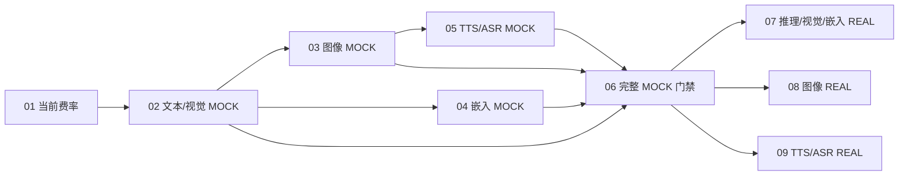

# 模型费用 MVP 任务索引

task_id: model-pricing-mvp-20261019

发布依据：用户于 2026-10-19 明确确认九票拆分。此索引与九张独立任务票构成本地 tracker，不创建远程 issue，不启动实现。

来源：[业务规范](spec.md)、[API 规范](api-spec.md)、[机器契约](openapi.json)、[访谈与审计](interview.md)。源规范此前四项属于阶段分组；实际排期以本次已确认的九个纵向切片为准。源规范没有被关闭或改写，之前未执行的质量评分不冒充已经通过。

## 任务与阻塞

| 任务 | Blocked by | Status | 验收行为 |
|---|---|---|---|
| [01 模型当前费率](issues/01-model-current-pricing.md) | 无 | resolved | 管理员查看、保存、刷新模型费率，无版本操作；离线通过，目标库迁移未执行 |
| [02 文本/视觉 mock](issues/02-text-vision-mock-billing.md) | 01 | ready-for-agent | 模拟消费、订单、企业/成员账务及展示闭环 |
| [03 图像 mock 折算](issues/03-image-mock-conversion.md) | 02 | resolved | 图片用量折算、扣账及展示；代码与离线验证完成，PostgreSQL 复核待独立记录 |
| [04 嵌入 mock](issues/04-embedding-mock-billing.md) | 02 | resolved | 仅输入 Token、批量子调用与账务展示；审核修复及 PostgreSQL 20/20 通过 |
| [05 TTS/ASR mock](issues/05-audio-mock-conversion.md) | 03 | ready-for-agent | 原始音频/字符用量、折算及账务展示 |
| [06 完整 mock 门禁](issues/06-mock-completion-gate.md) | 02、03、04、05 | ready-for-agent | 全场景断言、可恢复报告、拒绝未通过的 REAL |
| [07 推理/视觉/嵌入真实验证](issues/07-text-vision-embedding-real.md) | 06 | ready-for-agent | 最低规格、有效返回、实际用量与账务核对 |
| [08 图像真实验证](issues/08-image-real.md) | 06 | ready-for-agent | 最低有效生成、计次、用量及账务核对 |
| [09 TTS/ASR 真实验证](issues/09-audio-real.md) | 06 | ready-for-agent | 最低有效音频、计次、原始用量及账务核对 |

ready-for-agent 表示票已发布，不能跳过 Blocked by、验收或已有操作授权边界。01 的代码及离线范围已完成，下一开发入口为 02；不代表目标库迁移或真实调用获准。

边只表示必要业务前置，不授权共享代码并行写入。03/04、07/08/09 无相互阻塞关系，但改动重叠时须单线程协调。

## 验收覆盖

| 主规范验收 | 承担任务 |
|---|---|
| AC01 模型清单与旧功能替换 | 01、06 |
| AC02 API 契约与旧操作停用 | 01 管理、02 订单与旧 mock、06 汇总 |
| AC03 两种计量模式与输入约束 | 01、03、04、05、06 |
| AC04 管理保存幂等与并发 | 01、06 |
| AC05 旧订单快照与当前调价 | 01、02、03、05、06 |
| AC06 企业/成员/流水一致 | 02–09（各自范围） |
| AC07 未知、超预占与成本 | 02–09（各自范围） |
| AC08 调用点覆盖与可信身份 | 02–06 建立并验证，07–09 真实核验 |
| AC09 真实三次限制与恢复 | 06 建立计次机制，07–09 验证实际次数 |
| AC10 各模型接入与计费独立结论 | 07 推理/视觉/嵌入、08 图像、09 TTS/ASR |
| AC11 历史账务与迁移保护 | 01、02、06 |
| AC12 范围与环境保护 | 所有任务 |
| AC13 先完整 mock 后真实 | 02–06 保证门禁，07–09 消费门禁 |

## 执行与恢复约束

- 当前发布检查仅验证任务数量、依赖及文字约束，不代替应用测试或业务验收。
- 先用 mock 跑通完整的数据与计费流程，通过后再做真实模型测试。06 未完成或报告失效时，07–09 不可开始真实调用。
- 真实阶段调整代码后重跑受影响 mock，报告摘要匹配才发出真实请求；三次计数不能按票、运行批次或进程重启归零。
- 已确认的真实调用预算是每供应商/模型/能力最多三次厂商最低有效规格。没有整体固定金额上限，但不授权无限次数、规格升级或备用供应商探测。
- 迁移、配置/费率写入、账务写入和进程操作按适用授权及恢复要求执行；发布票不会替这些行为自动扩大授权。
- 每票完成时记录实际检查、产物及残余限制，不能仅勾选；账本、审计及历史记录不通过删数据回滚。
- 本主题后续变更追加入访谈与审计；当前恢复入口为 02，01 的实现与离线证据已落盘。

## Decisions-so-far

- 01：每供应商＋精确模型 ID 一套当前费率，永久幂等返回首次响应；默认 registry 不猜测真实计量协议。沿用显式 schema 迁移，保留历史及不可变保护，费用页同批移除版本管理。见 [票 01](issues/01-model-current-pricing.md)、[离线证据](evidence-01.md)、[迁移恢复](migration-v3.md)。
- 02：共享模型执行器复用现有账本；tenant＋持久业务键限定唯一意图，其他成员重放隐藏；模型身份/完整费率/规格不可变。TEXT/VISION MOCK、未知预占、恢复、四查询及现有消费页完成离线验证；未接通旧 SDK 路径 fail-closed，REAL 等 06 门禁。见 [票 02](issues/02-text-vision-mock-billing.md)、[证据](evidence-02.md)；下一 frontier 为 03、04，目标环境验证与 REAL 均未据此宣称通过。
- 03：图像 MOCK 按本地解码且规格有效的图片数量计量，FOLDED 使用精确比例并仅在最终积分向上取整；部分、空、未知产物分别处理，共用既有预占、快照和账本。旧图片入口缺可信上下文时提前拒绝，真实模型与存储调用为零。代码及离线验证完成，PostgreSQL 复核由主线程独立记录；见 [票 03](issues/03-image-mock-conversion.md)、[证据](evidence-03.md)。
- 04：嵌入 MOCK 仅计输入 Token，稳定批次按实际传输生成子订单，失败或未知时停止后续调用；后续预占/存储中断保留已消费证据，未结算重放不报告完成。审核修复后 PostgreSQL 20/20 通过（15 嵌入＋5 历史），20 个临时 schema 已清理，真实调用为零；见 [票 04](issues/04-embedding-mock-billing.md)、[证据](evidence-04.md)、[本轮 PostgreSQL 结果](pg-embedding-result.json)。本票完成不放行 REAL。
