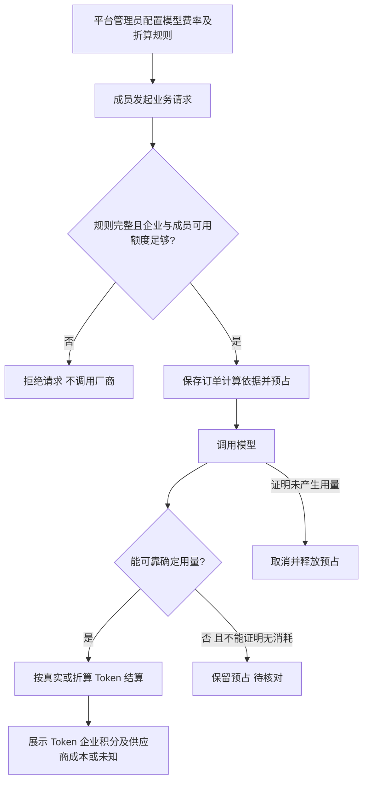
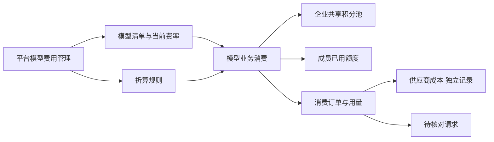
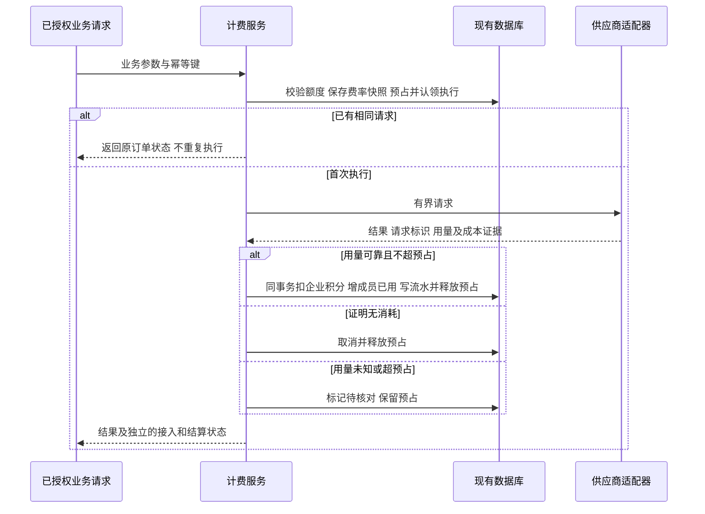
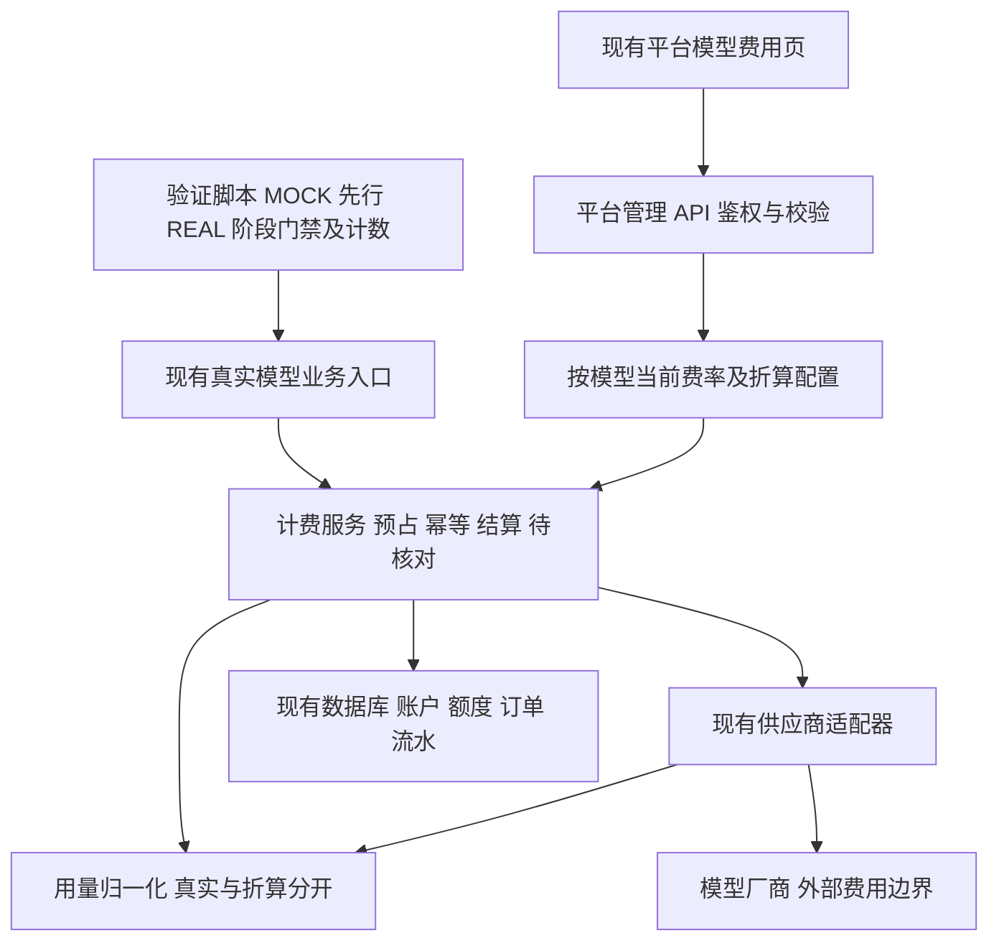
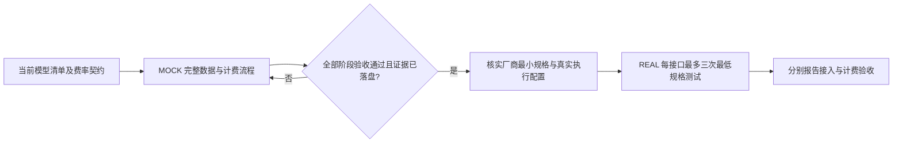
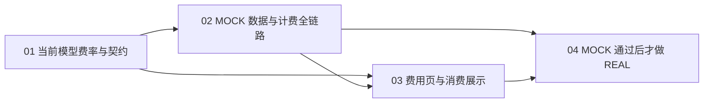

# 模型费用管理与最低费用接入验证 MVP

状态：访谈完成，方案待整体确认；未进入实施。

Status: needs-triage

## 规范入口与当前流程

本轮 `/spec` 只产出待审规范，不启动实现。Phase 1 的角色、现状、目标、动机、验收与 Phase 2 的范围已由 Q1–Q12 确认；Phase 3 重新核查 API、schema、隔离中间件与不可变约束；当前为 Phase 4 草案审阅。用户确认草案后才进入质量门禁及本地 issue 拆分。

- [API 人读规范](api-spec.md)：目标接口、完整请求/响应、权限、校验、幂等、错误、停用旧入口。
- [OpenAPI 3.1 JSON](openapi.json)：7 个目标操作和 4 个停用操作的机器契约。
- [数据结构草案](schema-draft.sql)：PostgreSQL 新表与订单引用；未执行，不能代替正式迁移。

最新用户纠正覆盖此前兼容表述：`mock_fixed/mock_text` 和旧版本管理属于本次优化对象，不保留两套费率管理。现有费用页和 price-rules 列表直接升级；历史账务保留。业务 API 的具体提案以 api-spec.md 和 openapi.json 为准，尚未宣称用户已逐项确认。

最新执行顺序（用户明确修正，优先于此前表述）：**先用 mock 跑通完整的数据与计费流程，通过后再做真实模型测试。** mock 是同模型、同计费链路的供应商替身，不能以“优化旧 mock 功能”为由跳过此阶段。旧 mock_fixed/mock_text 两种功能价升级与该 mock 阶段不矛盾：前者是被替换的旧计价对象，后者是继续保留并先执行的验证方式。

task_id：model-pricing-mvp-20261019  
更新时间：2026-10-19（Asia/Singapore）  
来源：本次用户 Q1–Q12 答复，详见 [访谈记录](interview.md)。

## 结论与交付范围

沿用现有平台模型费用页与企业共享积分池，为已配置、已有调用实现的模型补齐按模型 ID 定价、Token 用量记录、企业与成员消费结算。先用 mock 跑通完整数据与计费流程并通过阶段门禁，再进行最小真实调用验证。供应商成本与企业积分分别记录。

MVP 不提供费率版本管理，每个模型使用一套当前费率与折算规则；订单保存发起时的计算依据，调价仅影响新请求。旧 mock_fixed/mock_text 独立计价与版本操作由同模型计价替换；不能删除 mock 验证能力。历史订单、费率、流水继续可追溯。真实调用成本不明就显示未知，不以估算金额填充实际成本。尚无可靠用量依据的请求进入待核对。

收益是让已有模型调用与现有积分账本形成可验证闭环。主要代价是补充各供应商的用量提取及模型配置；主要风险是当前适配器丢弃用量、模型真实身份与最低计费规格尚未核实，以及真实测试会产生供应商费用和测试账务记录。

角色：平台管理员配置费率；企业成员发起模型业务；企业管理员及成员沿用现有授权查看消费；执行者核对请求、用量与账务证据，用户验收 MVP。

不在本轮：视频真实生成接入、企业额度发放后台、个人额度申请审批、新增供应商平台、账单自动同步、自动成本估算、生产发布。

## 已确认业务与技术规则

| 项目 | 规则 | 来源 |
|---|---|---|
| 模型粒度 | 按模型 ID 自定义费率；类型用于分类，不引入能力定价维度；供应商同名模型内部区分 | Q8 |
| 用量计费 | 只用真实 Token 或折算 Token 计算企业积分，不直接按图片张数或时长扣积分 | Q6、Q7 |
| 输入输出 | 支持输入、输出 Token 分别定价；不适用的方向不伪造用量 | Q8及数据真实性约束 |
| 折算 | 非 Token 用量可按比例折算；比例尚未确定，不能将说明示例当成默认值 | Q7 |
| 费率管理 | 每模型一套当前规则，无版本创建、启用、停用流程 | Q9；按 Q8 上下文解释“统一费率” |
| 订单依据 | 请求开始时保存费率及折算依据，后续调价不影响该请求 | Q11 |
| 供应商成本 | 与积分分开；拿不到实际金额显示未知，不自动填估算金额 | Q10 |
| 展示 | 展示 Token 用量，并明确真实或折算；不能可靠获取时显示未知 | Q10、Q12 |
| 未知用量 | 进入待核对，不能以零用量或免费成功结束 | Q12 |
| 验收 | 接入可用和计费一致性分别验收 | Q2 |
| 真实测试 | 同供应商＋模型＋能力最多三次；失败和自动重试计入；异步轮询单独记录，不计新增生成 | Q3、Q5 |
| 视频 | 清单标记未接入，本轮后置 | Q4 |
| 阶段门禁 | MOCK 全链路及异常场景通过并落盘证据后才允许 REAL；不自动由 mock 切到真实 | 用户最新两次流程修正 |

“能力”仅用于测试计次：例如同模型文本与视觉分别覆盖，不成为费率配置维度。

## 拟议业务流程图

## 拟议业务框架图

## 拟议技术流程图

## 拟议技术框架图

以上四图表达拟议方案，不代表真实模型已经与账本接通。mock 阶段的“调用模型”指同协议 mock 供应商；只有阶段门禁通过，真实阶段才允许请求厂商。

### 强制阶段流程

## 当前实现证据与缺口

| 对象 | 已核实源码事实 | 尚待完成 |
|---|---|---|
| 前端费用页 | `frontend/src/pages/PlatformModelPricing.tsx:10` 仅 mock 模型；有版本管理界面 | 真实模型清单、当前费率与用量展示 |
| 费用契约 | `backend/app/schemas/billing.py:39` 起仅支持 mock 功能并要求版本号 | 按模型配置接口，兼容现有数据 |
| 订单账务 | `backend/app/services/billing/orders.py:138` 起预占和快照；`:201` 起快照结算与事务扣账 | 接入真实供应商结果，不沿用 mock 专属授权和无消耗假设 |
| 推理/视觉 | `backend/app/services/llm.py:120`、`:176` 起有调用适配；配置为同 endpoint | 核实实际模型身份、运行配置、完整 usage 与有界输出 |
| 图像 | `backend/app/services/image_generation.py:124` 起有 Apilio 适配，当前配置 high | 核实最低有效规格并保留用量证据 |
| embedding | `backend/app/services/llm.py:377` 起，当前 multimodal | 保留 usage，覆盖独立配置与返回校验 |
| TTS | `backend/app/services/tts.py:13` 起有调用，返回音频路径 | 核实计量字段与最低有效请求，补用量记录 |
| ASR | `backend/app/services/llm.py:267` 起有识别流程 | 核实实际 auto 路由、最低音频、存储副作用与用量 |
| 视频 | `backend/app/api/videos.py:261` 起为编排预览 | 仅标未接入，后置 |

backend/.env 仅用于确认模型配置与凭据是否存在；文档不保存凭据。当前源码与文件配置不能证明运行进程已加载同一配置。

## 最小实施路径与实现约束

1. 先核实 5173 所连后端进程、配置来源和目标数据库环境。先完成当前模型清单和可配置费率契约；厂商文档读取可以先行，但任何真实模型探测/生成调用必须在 MOCK 门禁通过之后。
2. 给出每模型的原始计量来源、折算规则与费率候选值，以及单次最小测试参数。未核实的数值保持未配置，不能用猜测或示例填充。不同计量规格需匹配不同折算依据，MVP 先限制到已定义规格。
3. 先写最小低层测试，再补当前费率契约、用量记录与费用页；优先复用现有账务，不重构无关业务。现有价格不可变触发器不能用原地改价绕过；拟新增一张当前模型价格表，订单增加模型引用与计量数据，旧价引用改为与模型引用互斥；具体见 schema-draft.sql。正式迁移须核实目标环境并单独授权，取消版本功能不等于删除历史数据。
4. MOCK 阶段先打通一条文本链路，再覆盖纳入的视觉、图像、嵌入、TTS、ASR 类型：使用真实模型 registry 的测试映射，通过 mock 适配器返回可控响应，跑通配置保存→身份/权限→预占→调用→用量提取/折算→订单→企业余额→成员已用→流水→查询展示。同业务多次子调用逐次追溯；所有纳入入口列入覆盖清单。
5. MOCK 阶段必须覆盖成功、幂等重放、调价中的订单、额度不足、确定无消耗、未知消耗、超预占、写账回滚及越权。记录 execution_mode=MOCK，和 REAL 数据清楚区分；mock 不连接模型厂商或真实存储，不消费三次真实预算。未通过不得执行 REAL，即使真实探测请求很短也不例外。
6. MOCK 数据和计费全链路全部通过且证据持久化后，方进入 REAL：核实真实模型身份、厂商最低有效规格和实际配置值；准备有界计次、请求参数摘要与恢复入口，关闭隐式重试、备用模型和额外探测调用。最多三次而非必须三次，失败计入，轮询单独有界。分别核对厂商结果与同一计费链路的实际账务。

优先复用现有积分精度及总额向上取整到 0.0001 积分的规则（`backend/app/services/billing/amounts.py:8-9,43` 起），不新增中间取整造成多扣。折算用精确比例，最终积分统一取整；客户端不提供可信结算用量。

## 验收与证据要求

| 验收场景 | 方法与通过条件 |
|---|---|
| 模型配置 | 定向组件/API 测试：按模型保存当前规则；非平台管理员不能改；非法值拒绝；未配置规则不能消费 |
| 真实与折算 | 单元及适配器测试：保留原始用量来源，真实与折算不混淆，成本缺失显示未知；不把 Token 当成货币成本 |
| 调价 | 测试开始请求后修改费率；旧请求仍用原计算依据，新请求使用当前规则，无需版本操作 |
| 共享账本 | API/事务测试：同订单企业扣额等于成员增加额及流水；重复请求不重复调用或扣账；额度不足不调用厂商 |
| 异常 | 单元/API 测试：超时、未知用量、超预占进入待核对；证明无消耗才释放；失败结果不伪造成功 |
| 真实接入 | 每个纳入的模型/能力保存脱敏请求 ID、最小参数、次数、响应与产物有效性证据；最多三次 |
| 真实计费 | 保存专用测试请求对应的用量、快照、企业及成员前后差额和订单流水引用；接入与结算分别报告 |

MOCK 阶段完成条件：AC01–AC08、AC11–AC12 中相关离线/事务/组件场景全部通过，覆盖每个纳入能力的可控成功与异常响应，账务前后差额和查询展示一致；报告明确 commit/工作区摘要、配置摘要、场景及结果，不含凭据。存在必测失败、测试环境缺失或未完成迁移授权时，停留 MOCK，不得把跳过算通过。

REAL 阶段入口需校验 mock 报告内容及代码/契约摘要一致、必测项通过、目标为已确认测试环境且计次可落盘；代码或计费规则有变化使报告失效，重跑受影响 mock 场景。REAL 单独报告接入及计费结果，不能用 mock 成功替代真实接入成功。用户验收后进入后续视频接入或额度申请阶段。

## 风险、恢复与权限边界

- 真实测试会产生厂商费用，不可保证退款；授权上限是每接口最多三次最小规格，不是无限重试或不限规格。
- ASR 可能涉及临时对象存储；执行前记录临时资源归属及清理结果，不能只统计模型 HTTP 调用。
- 用量未知会保留预占，可能影响可用额度；必须有待核对清单与人工恢复入口，不自动释放或重复调用厂商。
- 真实账务测试先明确专用租户/成员与目标数据库，不把历史企业消费归入本轮证据；不得默认写入生产账户。
- 若涉及数据迁移、配置写入、费率写入或重启，先提交具体影响、备份与恢复方案，写危险操作标志；未获得对应授权不执行。无需这些动作的部分可在整体方案确认后直接开发。
- 回退优先关闭新增真实计费入口、恢复应用文件与配置备份，保留账本及订单证据；已经发生的厂商费用不能靠恢复数据库消除，不删除流水回滚消费。

## 本次实际验证

仅完成源码与配置的只读核查、需求逐项对照及文档结构检查。未核查运行时、未联网核价、未执行应用测试、未发起真实模型调用、未修改数据库或重启进程。

下一步入口：用户整体确认规范后先开发并验证 MOCK 完整链路，MOCK 门禁通过后才做真实模型测试。本轮仅修正规范，不执行任何模型调用或写账。

## API 与数据设计选择

| 选择 | 优点 | 代价/风险 | 本草案选择理由 |
|---|---|---|---|
| 直接改旧 price_rules 行使其可编辑 | 少一张表 | 必须放松不可变历史保护，旧订单外键与旧协议含义混杂 | 不采用；不能因 MVP 削弱历史保护 |
| 新增当前模型价格表，升级同一个费用页和 API 资源 | 一模型一当前价格，历史订单依据不变，无第二套用户管理流程 | 新增一张表、订单两列及引用约束；需显式迁移 | 推荐；贴合用户不做费率版本与优化旧功能要求 |

技术 schema 版本/checksum 属于现有迁移完整性机制，不是用户拒绝的费率版本功能；保留该机制，不能冒充不需要迁移。

新价格表的身份字段 model_key/provider/model_id 创建后不得修改；更新只替换 current_pricing_json、updated_by、updated_at，需同事务写审计。删除价格不提供 API。订单发起时复制完整配置与模型身份；计量数据在订单终态保护下不可篡改。新计量计算分支按 model_price_id 区分；旧订单恢复/对账仍使用旧规则与旧计算，不能把平坦旧 usage_json 误读成新 envelope。

API 改动是有意的单批升级：费用页同步切换，旧版本操作返回 410；不保留可消费的 mock 功能。回退时新增数据不破坏旧数据，但旧后端不认识 v3 checksum，不能直接启动旧二进制：必须保留可识别新增 schema 且关闭真实入口的安全构建，或在确认没有新订单且恢复不会抹账时使用已验证完整备份。不得删除新消费记录来强行降 schema。

## 优先级、拆分与顺序

本轮是一个交付主题，正式本地 issue 在草案确认和质量门禁后拆成四项；当前不标 ready-for-agent。

| 拟议子项 | 优先级 | 依赖 | 交付与原因 |
|---|---|---|---|
| 01 当前模型费率与契约 | Critical | 无 | registry、价格校验、精确折算、schema 迁移草案；其他项都依赖稳定身份及计价 |
| 02 MOCK 计费全链路与可信用量 | Critical | 01 | 同模型价格下的 mock 适配、预占、snapshot、未知态、幂等；必须数据跑通后才接真实厂商 |
| 03 费用页与模型消费展示 | High | 01、02 | 升级旧页面、移除版本/mock 操作、展示两种 Token 和未知成本 |
| 04 有界真实验证与交付 | High | 01–03 的 MOCK 验收全部通过 | 核实厂商最小规格、每接口最多三次、完整计次及逐模型/账务证据 |

图中另附强制阶段流程及交付依赖图；前四图分别表达业务流程、业务框架、技术流程与技术框架。

## 可执行验收编号与测试计划

1. AC01：费用页列出运行配置中的去重模型 ID 和类型；mock_fixed/mock_text 不出现在可编辑清单；视频显示未实现。
2. AC02：七个目标 API 的权限、请求体、分页、响应及状态码符合 openapi.json；四个旧操作正确返回 410，且不写数据库或调用厂商。
3. AC03：真实/折算两种模式互斥；重复字段、无效比例、零/负费率、溢出、无模型协议依据的配置拒绝；所有说明示例均不得自动写入运行配置。
4. AC04：PUT 同键同体重放不改价，同键异体/异模型冲突；不同键并发保存最后提交生效且有审计。
5. AC05：请求开始后的调价不影响已有订单；新订单使用新当前价格；管理员无版本创建、启用、停用流程。
6. AC06：新调用的企业扣额、成员已用增量与唯一 CHARGE 流水一致；预占不足时不调用；同一意图重复请求不再次调用或扣账。
7. AC07：用量未知或超预占进入待核对并保留预占；证明无用量才取消释放；成本未知为 null 并显示未知；真实零与未知不混淆。
8. AC08：真实适配器列表及各调用点形成覆盖清单；启用计费后未绑定身份的调用拒绝；不因 mock 停用而给业务新增 mock 专属权限依赖。
9. AC09：每个纳入供应商/模型/能力生成不超过三次的持久计次证据；SDK/业务重试、批量子调用均计数；计次写入失败即不调用；轮询有独立次数/时间边界。
10. AC10：文本、视觉、图像、embedding、TTS、ASR 各自记录接入与计费两个验收结论，只有两者均通过的项目标通过；失败、待核对、未配置逐项列出，不能把一个模型通过泛化为全部模型。
11. AC11：旧订单/流水/额度与旧查询能回读；历史不可变约束继续生效；迁移只经授权执行且有备份、checksum 和恢复验证。
12. AC12：没有新增凭据管理、视频生成实现、额度申请审批或生产发布；不关闭全局隔离或自动启用后台 worker。
13. AC13：MOCK 通过前 REAL 被执行器硬性拒绝；MOCK 覆盖配置、订单、预占、企业余额、成员已用、流水、展示及异常；MOCK 不连接真实模型/存储且不消耗三次真实调用预算。

| 层级 | 最小用例组与计划数量 | 实际执行 |
|---|---|---|
| 单元 | 18 组：registry 去重/碰撞、两种计量、折算精度、边界/溢出、未知与零、成本、重试计次、调用上界、请求身份、上下文缺失 | 未执行 |
| API/事务集成 | 16 组：七操作成功与角色/租户拒绝、完整替换、幂等、并发、调价快照、扣账原子性、未知保留、旧入口停用及历史读取 | 未执行 |
| 前端定向组件 | 8 组：清单/分类、两种模式、输入校验、保存、权限、未知显示、Token 来源、旧版本操作消失 | 未执行 |
| 离线契约检查 | JSON 解析、局部引用、路径参数、操作数、请求及响应示例与人读规范对应 | 本轮运行并单独记录，不等同 API 测试 |
| MOCK 全流程 | 纳入能力的可控成功与失败，同数据库事务及 UI 查询数据验证；产出 mock-gate.json；未通过禁止真实调用 | 未执行 |
| 真实调用 | MOCK 门禁通过之后，活跃的供应商/模型/能力去重集合 N，每项 ≤3 次，总上限 3N；N 在执行前运行清单确定，不含视频和未选备用 provider | 未执行 |

默认不运行全量构建、全量测试或 E2E；需要浏览器补充验收时只走费用配置与消费查看关键路径，不额外调用付费模型。

## 文件范围与工作量估算

以下是拟议实现位置；源码路径已经核查存在，新文件明确标“新增”。测试数量为计划，不是已通过。

| 文件 | 目标改动 |
|---|---|
| backend/app/api/billing.py | 七目标契约与四个旧操作停用，保持其他额度接口 |
| backend/app/schemas/billing.py | 增加模型/价格/计量契约，替换旧费用页契约 |
| backend/app/models/billing.py | 当前模型价格表、新旧订单引用与计量字段 |
| backend/app/services/billing/migration.py | 显式 v3 迁移、完整性 checksum、快照保护 |
| backend/app/services/billing/orders.py | 真实模型订单与旧订单分支、预占/结算/恢复 |
| backend/app/services/billing/amounts.py | 精确折算计算，不改变旧历史计算 |
| backend/app/services/billing/model_pricing.py（新增） | 脱敏 registry、当前费率及原子保存 |
| backend/app/services/billing/metering.py（新增） | 受信调用上下文与用量归一化 |
| backend/app/services/llm.py、image_generation.py、tts.py | 保留 usage 和成本证据，受计费上下文约束 |
| frontend/src/pages/PlatformModelPricing.tsx | 同页面升级真实模型当前费率管理 |
| frontend/src/api/client.ts | 对应 typed API 客户端 |
| backend/scripts/verify_model_billing.py（新增） | 有界真实调用及证据汇总，默认只读预检查 |
| backend/tests/test_model_pricing.py、test_model_metering.py（新增） | 单元与事务/API 契约用例 |
| frontend/tests/platform-model-pricing.test.tsx | 替换旧版本流程期望，验证当前模型费率 |

业务调用点及现有消费展示文件在实施前通过源码清单具体化；不能在缺少清单时声称已覆盖全部业务入口。该事实调查不要求用户猜文件名。

工作量仅为规划估算：契约/registry 2–4 人时，迁移与计费规则 4–8 人时，六类能力适配和调用点盘点 6–12 人时，前端 3–5 人时，定向测试与验证 4–8 人时；合计 19–37 人时。AI 执行时间受厂商协议、目标环境、审批及真实请求延迟影响，当前无证据给出可靠分钟数；不将估算当交付承诺。
