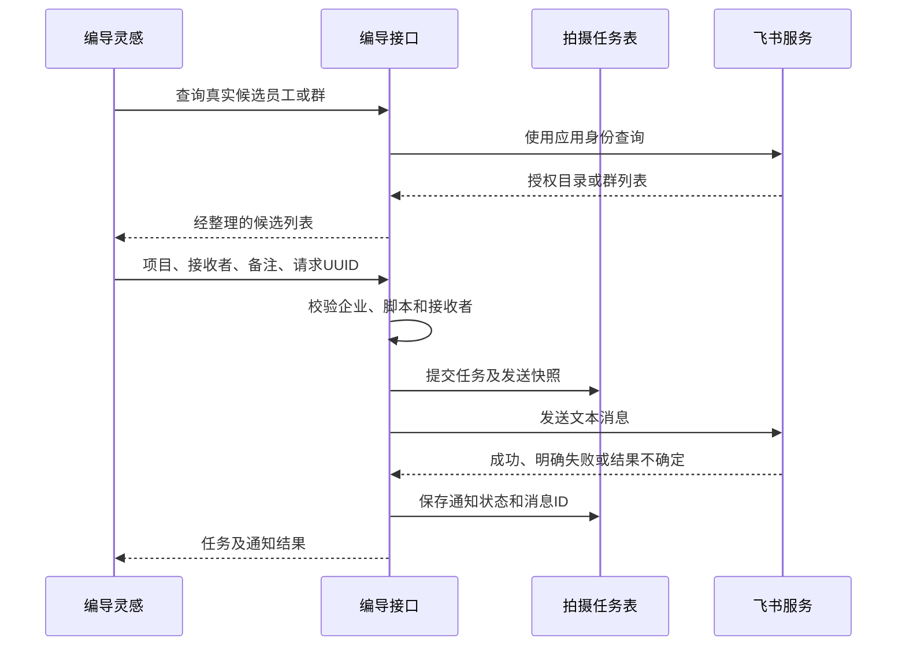

# 编导灵感：飞书推送最小接入设计

> 状态：首版代码已实现，企业实际发送待配置后联调。以下保留设计依据，实际部署和实现差异见第 12 节。

## 1. 目标与首版边界

只接入现有“编导灵感 → 脚本更多菜单 → 推送飞书”。保留当前“推送同时创建拍摄任务”的业务含义，将模拟人员与模拟发送替换为真实飞书调用。

首版支持：

- 人员、群聊两个选择页签；每次选择一个员工或一个内部群。
- 自动查询飞书授权范围内的员工和机器人所在群，姓名/群名搜索、手动刷新。
- 固定文本通知：脚本名称、脚本结构数量、发起人、备注、脚本链接。
- 复用拍摄任务列表展示通知结果，发送失败可以重试。
- 同一企业绑定一个自建应用，应用凭证配置在服务端环境变量中。

后续扩展项：多选批量推送、自动触发规则、卡片交互、已读/接收回执、飞书登录、完整组织架构同步、独立通知中心。

设计假设：收件人已有本系统账号，并拥有该脚本所属企业的访问权限。飞书授权员工不等于系统已注册用户，接入时要验证这一前提。如果收件人没有系统账号，需要将交付方式改为飞书内可读的脚本正文/文件，另行补充长文本或文件处理；不能将一个打不开的链接当作交付完成。

## 2. 改造前代码的实际行为

| 改造前位置 | 原行为 | 接入修改 |
|---|---|---|
| `frontend/src/pages/DirectorProjects.tsx:34` | 写死“飞书 → 拍摄部1 → 张三” | 删除模拟目录以及请求失败后的模拟兜底 |
| `frontend/src/pages/DirectorProjects.tsx:183` | 始终使用第一个部门的第一个成员 | 使用用户在弹窗内实际选择的接收者 |
| `backend/app/api/director.py:145` | 入参用 Literal 限制模拟部门、张三 | 改为接收者类型、ID、备注、请求 UUID |
| `backend/app/api/director.py:398` | 目录接口返回常量 | 调用飞书并返回真实候选对象 |
| `backend/app/api/director.py:414` | 只插入 ShootingTask，未调用飞书 | 创建记录、调用飞书、保存真实发送结果 |
| `backend/app/models/__init__.py:114` | 只有拍摄任务状态 | 增加独立通知状态和发送追踪字段 |
| `frontend/src/pages/Login.tsx:15` | 登录后固定回到首页 | 支持经过校验的站内返回路径 |

改造前的“推送成功”只代表数据库写入成功。真实接入后，只有收到飞书业务成功响应才能显示“已发送”。

## 3. 页面与操作流程

保留原来的更多菜单，将后续多级菜单换成一个小弹窗：

```text
推送脚本到飞书                         ×
脚本：夏季新品口播脚本

[ 员工 ]  [ 群聊 ]
[ 搜索姓名 / 群名              ] [刷新]
○ 张三                 运营部（有数据时显示）
○ 李四                 设计部

备注（选填）
[ 请按照分镜完成首版拍摄              ]

通知预览
【拍摄任务】夏季新品口播脚本
脚本结构：6 段
发起人：当前登录用户
备注：请按照分镜完成首版拍摄
查看脚本：系统脚本链接

                     [取消] [发送并创建任务]
```

交互规则：

1. 打开弹窗时加载所选页签的数据，避免进入编导页面就扫描整个通讯录。
2. 人员列表默认平铺，部门信息只作辅助显示；单独授权但没有部门信息的员工也必须能被选中。同名员工可附加 ID 尾部用于区分。
3. 未配置、加载失败、没有可选人员/群，分别给出明确提示；失败时允许重试，不展示假人名。
4. 空脚本、未选接收者、正在发送时禁用发送按钮；生成/修改正在进行的项目先等待保存完成。
5. 发送成功提示“已发送给张三”，可进入拍摄任务。
6. 明确失败提示“拍摄任务已创建，飞书通知失败”，显示原因和重试入口。
7. 请求超时或进程异常导致无法确定结果时显示“发送结果待确认”，不得当作成功或直接创建新通知。

## 4. 消息内容与打开脚本

首版使用固定文本，不依赖模板管理或卡片回调。后端从当前已保存的项目、脚本结构和登录用户生成正文；前端不提交任意脚本地址、发起人姓名或完整消息对象。

```text
【拍摄任务】夏季新品口播脚本
脚本结构：6 段
发起人：王五
备注：请按照分镜完成首版拍摄

查看脚本：https://系统域名/director-inspiration/123/workspace
任务编号：456
```

发送时的消息内容保存为快照，重试复用原内容；链接打开的是项目当前保存版本。首版不引入脚本版本归档。

链接必须由服务端配置的 `APP_PUBLIC_BASE_URL` 拼接，不能使用 localhost 或前端提供的任意域名。沿用系统当前登录和租户校验：

- 已登录且有权限：直接进入工作台。
- 未登录：记录目标站内路径，跳转登录，成功后返回原脚本。
- 已登录但不属于该企业：显示无权访问，不自动授予权限。

需要调整 `frontend/src/api/client.ts` 的 401 跳转，以及 `Login.tsx` 的成功跳转。返回路径只接受当前站点的合法相对路径，拒绝外域和 `//` 开头地址。

## 5. 后端最小结构与飞书调用

新增一个 `backend/app/services/feishu.py`，使用项目已有 `httpx` 完成令牌、目录和消息请求。业务入口仍位于 `director.py`。



首版在请求内执行一次有超时限制的发送，不新增消息队列。外部调用期间不持有数据库行锁；任务先持久化，发送后再提交结果。无法形成跨数据库与飞书的原子事务，故必须保留“待确认”状态处理飞书已收、数据库未写回等异常。

### 5.1 飞书接口清单

以下路径统一加 `https://open.feishu.cn/open-apis`，沿用原设计的应用身份与 ID 约定。

| 用途 | 接口 | 调用时机 |
|---|---|---|
| 获取令牌 | `POST /auth/v3/tenant_access_token/internal` | 缓存过期时 |
| 查询授权范围 | `GET /contact/v3/scopes` | 加载/刷新人员候选名单 |
| 展开子部门 | `GET /contact/v3/departments/{department_id}/children` | 授权部门存在下级时 |
| 查询直属员工 | `GET /contact/v3/users/find_by_department` | 对授权父部门和各子部门查询 |
| 查询单独授权员工 | `GET /contact/v3/users/{user_id}` | 授权范围直接包含员工时 |
| 查询群 | `GET /im/v1/chats` | 加载/刷新群页签 |
| 发送消息 | `POST /im/v1/messages` | 用户点击发送或重试 |

人员查询使用 `user_id_type=open_id`、部门查询使用 `department_id_type=open_department_id`。所有分页查完后按 `open_id` 去重，不能漏掉父部门直属人员。查询部门名称按需增加单个部门详情接口，平铺名单不强制要求该接口。

首版飞书数据授权采用“部门＋指定员工”。若范围中存在用户组而实现暂不支持展开，应明确提示该分支未覆盖，不得把不完整名单标记为加载成功。通讯录用户组和聊天群分别使用 `group_id`、`chat_id`，不能混用。

候选名单建议缓存 5 分钟；Token 按响应 `expire` 提前约 60 秒过期。缓存键包含系统租户与应用 ID。项目已有 Redis，可复用；未配置时单进程内存缓存足够，不能让缓存失效退回模拟数据。发送时校验候选来源，飞书仍是当前实际可发送范围的最终判断方。

### 5.2 发送参数

```json
{
  "receive_id": "ou_example",
  "msg_type": "text",
  "content": "{\"text\":\"【拍摄任务】示例脚本……\"}",
  "uuid": "每次逻辑通知对应的固定UUID"
}
```

个人请求使用 `?receive_id_type=open_id`，群使用 `?receive_id_type=chat_id`。`content` 是 JSON 序列化后的字符串；官方 SDK 的请求模型也将 `receive_id`、`msg_type`、`content`、`uuid` 定义为字符串。[官方请求模型](https://github.com/larksuite/oapi-sdk-python/blob/v2_main/lark_oapi/api/im/v1/model/create_message_request_body.py)

同时检查 HTTP 状态和飞书响应中的 `code`；HTTP 200 但业务码非零不能显示成功。成功保存 `message_id`。明确鉴权过期可刷新 Token 后复用相同 UUID 重试一次；发送结果不明的超时不要无条件自动重发。

## 6. 复用的内部接口

沿用现有编导接口前缀，首版不用另开一套通用通知 API。

| 内部接口 | 设计变更 |
|---|---|
| `GET /api/director-projects/shooting-directory?type=user&refresh=false` | 返回员工；`type=chat` 返回群。响应含配置状态、候选项、刷新时间 |
| `POST /api/director-projects/{project_id}/shooting-tasks` | 按选中对象创建任务并发送；返回真实通知状态 |
| `GET /api/director-projects/shooting-tasks` | 原列表增加通知状态、错误摘要、接收者类型和名称；可选 `project_id` 过滤以查询超时请求结果 |
| `POST /api/director-projects/shooting-tasks/{task_id}/retry-notification` | 新增：对已有任务重试通知，不再创建拍摄任务 |

推送入参示例：

```json
{
  "recipient_type": "user",
  "recipient_id": "ou_example",
  "note": "请按脚本完成拍摄",
  "request_id": "ce7b71a7-d7d9-4fb0-af64-976f7d25dc6b"
}
```

`recipient_type` 为 `user` 或 `chat`。租户、接收者名称和发起人由服务端解析。前端保留一次逻辑操作的 `request_id`，网络重试复用；同一键换接收者、项目或备注返回冲突。

推送响应使用明确结构，如 `task_id`、`notification_status`、`recipient_name`、`error`。任务创建与飞书发送分别判断，前端不得沿用“请求没有抛异常就显示已推送”的逻辑。

## 7. 数据、状态与重复点击

扩展现有 `ShootingTask`，不新增通用通知任务表。

| 字段组 | 用途 |
|---|---|
| `recipient_type / recipient_id / recipient_name` | 真正的飞书消息目标与名称快照 |
| `notification_status` | `not_sent / sending / sent / failed / unknown` |
| `notification_uuid` | 新通知必填的请求 UUID；旧模拟记录保留 NULL；数据库对租户＋非空UUID建立唯一约束 |
| `notification_payload` | 保存实际发送正文，保证重试内容一致 |
| `feishu_message_id` | 飞书返回的消息 ID |
| `notification_error` | 可展示的失败原因，不包含凭证 |
| `notification_started_at / notified_at` | 判断发送是否停滞，以及成功时间 |

原 `status=pending/in_progress/completed` 继续表示拍摄任务状态，不能用于判断通知成功。飞书接受消息也不等于员工已读或已接收任务；任务列表可将“待接收”改为更中性的“待处理”。

个人推送可以把现有 `assignee_id/assignee_name` 填为对应飞书员工信息，但不把它自动当成系统用户主键。群推送只记录群接收者，负责人暂空，页面显示“未指定负责人”；不能把群 ID 填进人员字段。

重复与重试规则：

- 同租户、同项目、同接收对象仍有未结束任务时，复用/返回已有任务，成功发送的任务不因重复点击再次发送。可用项目行锁保护“检查＋创建”，提交后释放锁再调用飞书。
- 同 `request_id` 总是定位同一任务，不依赖前端按钮禁用保证去重。
- 重试通过原子状态更新取得发送资格，并复用原任务、消息正文和 UUID；并发重试只允许一个执行者。
- 只有有证据未发送的失败适合普通重试。超时、发送后写库失败、长期停留 sending 等情况归为 unknown，先核对结果；依赖飞书去重的重试必须受其有效窗口约束，超出窗口不能承诺无重复。
- 接收者错误、权限不足等明确错误展示原因，修复后再重试。
- 已有模拟记录迁移为 `not_sent`，保留记录且不自动补发；无有效飞书 ID 的旧任务禁用重试。
- 部署需为已有表执行幂等列/索引迁移，`create_all` 不会自动给旧表增加这些字段。

原项目删除会删除关联拍摄任务。首版维持此行为，但发送中阻止删除，避免发送与删除竞争；创建、重试和删除均按同一顺序获取项目行锁，再检查/更新任务，不能只在删除前做一次无锁查询。已经发送到飞书的消息不会随项目删除而撤回，打开被删除项目时显示不存在。

## 8. 服务端配置与使用范围

最小配置为以下三项，示例文件只放占位值：

```env
FEISHU_APP_ID=cli_example
FEISHU_APP_SECRET=由部署环境配置
APP_PUBLIC_BASE_URL=https://你的系统域名
```

凭证齐全时自动启用；可选 `FEISHU_ENABLED=false` 显式关闭。未填写 `FEISHU_SYSTEM_TENANT_ID` 时，后端查询数据库：只有一家有效企业才自动绑定；无企业或存在多家企业时拒绝自动选择。多企业部署需由管理员确定归属，并填入该可选配置。目录查询、创建、重试、缓存全部保留企业隔离，其他企业不能借用同一飞书应用读取人员或发送通知。

沿用当前登录与企业成员权限，不另建权限管理页面；未来需要细分编导发送权限时再扩展角色规则。App Secret 和 Token 不发给前端、不写业务错误响应。

飞书侧沿用已配置的自建应用、机器人及消息/通讯录权限。将应用可用范围和通讯录范围保持一致；群功能另核对群读取权限，并将机器人加入需要通知的内部群。权限是否真实生效以企业凭证联调为准。

## 9. 实施文件与顺序

| 文件 | 修改内容 |
|---|---|
| `backend/app/services/feishu.py`（新增） | Token、真实目录、群列表、文本发送、错误分类与缓存 |
| `backend/app/config.py`、环境变量示例 | 应用配置、系统租户绑定、系统公开地址 |
| `backend/app/api/director.py` | 替换模拟目录和入参，接通发送与重试，扩展输出 |
| `backend/app/models/__init__.py`、`database.py` | 扩展 ShootingTask，兼容旧数据，建立去重约束 |
| `frontend/src/pages/DirectorProjects.tsx` | 真实收件人弹窗，预览，发送结果与失败处理 |
| `frontend/src/pages/ShootingTasks.tsx` | 展示通知结果及重试，正确展示群目标 |
| `frontend/src/api/client.ts`、`types/index.ts` | 调整请求和响应类型、保存登录返回路径 |
| `frontend/src/pages/Login.tsx` | 登录后返回原脚本 |
| `backend/tests/test_director_workflow.py` | 将模拟收件人测试改为可控飞书响应测试 |

实施顺序：真实人员列表 → 个人文本发送与记录 → 群列表与群发送 → 失败/重复点击 → 登录后打开脚本 → 用真实企业账号完成验收。

## 10. 验收标准

1. 未配置或目录接口失败时，界面不再出现张三、拍摄部1等模拟数据。
2. 分页、多层部门、单独授权用户能正确合并，同一员工不重复；名单不完整有明确提示。
3. 在编导灵感推送一份已保存脚本，指定员工真实收到对应消息，拍摄任务保存消息 ID。
4. 推送到一个机器人已加入的内部群，群实际收到消息，群目标没有被误写为个人负责人。
5. HTTP 200 但飞书业务错误、网络超时、进程中断分别得到正确的通知状态。
6. 连点、重复 HTTP 请求、并发重试不新增重复拍摄任务；重试保持同一消息正文和 UUID。
7. 未登录收件人登录后回到脚本；无系统账号或无该企业权限的收件人不能被误认为已经拥有访问权限。
8. 其他租户无法读取本企业通讯录、发送消息或重试本企业任务。
9. 旧模拟任务不自动补发，也不被标记为真实通知成功。

## 11. 参考与核对范围

- 已读共享会话：[设计飞书提醒方案](https://chatgpt.com/share/6aa8b137-e9a4-83ee-8fcd-c08dd6bed847)。
- 本次核对官方 SDK 的[范围查询请求](https://github.com/larksuite/oapi-sdk-python/blob/v2_main/lark_oapi/api/contact/v3/model/list_scope_request.py)：应用身份、URL 和分页/ID 类型参数。
- 本次核对官方 SDK 的[群列表请求](https://github.com/larksuite/oapi-sdk-python/blob/v2_main/lark_oapi/api/im/v1/model/list_chat_request.py)：群查询 URL、令牌类型和分页参数。
- 本次核对官方 SDK 的[发送消息请求体](https://github.com/larksuite/oapi-sdk-python/blob/v2_main/lark_oapi/api/im/v1/model/create_message_request_body.py)：消息字段类型。
- 设计阶段未验证真实权限；实施后的联调结果见第 12 节。实际消息收取及脚本访问需要由指定测试收件人验证。

## 12. 实现与部署

已接入：员工/群单选弹窗、真实飞书 API 客户端、拍摄任务发送状态、明确失败重试、请求及业务去重、旧表迁移和登录返回脚本。首版发送在 HTTP 请求内完成，不运行独立通知 Worker。

### 配置

在实际后端环境文件（本地 `backend/.env` 或生产 `shared/.env`）填入：

```env
FEISHU_APP_ID=你的自建应用ID
FEISHU_APP_SECRET=你的应用密钥
APP_PUBLIC_BASE_URL=https://你的系统域名
```

应用 ID 和密钥齐全时自动启用，无需再填开关；已有 `FEISHU_ENABLED=false` 的部署需要移除该行或改成 true。可选的 `FEISHU_SYSTEM_TENANT_ID` 是本系统企业编号，只有多企业部署需要手工绑定；单企业自动识别。它不参与飞书鉴权，也不会发送给飞书。

`APP_PUBLIC_BASE_URL` 应是收件人可访问的 HTTPS 地址；`http://127.0.0.1` 无法用于真实脚本链接联调。示例文件中的凭证为空，功能不会启用；实际密钥只存于部署环境，不提交到代码仓库。

重启后端自动执行幂等迁移：旧模拟任务保持 `not_sent`，UUID 为 NULL，不发送历史通知。目录接口在未配置时返回 503，错误租户返回 403，前端展示对应提示。

### 已实现的细节

- API 返回完整 `ShootingTask`，其中包含 `notification_status`、`notification_error`、`feishu_message_id`、`can_retry_notification`；前端不再把所有 HTTP 200 都显示为推送成功。
- 目录接口同时返回脚本链接配置是否符合发送要求；地址不符合要求时，弹窗提前提示并禁用发送。创建前的配置或目录错误明确标记 `X-Notification-Outcome: not_started`，前端展示实际原因，不误报为发送结果待确认。
- `notification_uuid` 在同租户内唯一，同项目同接收对象的未完成任务也有数据库唯一索引，重复创建返回 409；原 UUID 重放返回原任务。
- 发送代码独立在 `services/director_notifications.py`；`services/feishu.py` 只负责飞书协议、错误分类和缓存。
- 消息正文、UUID、应用 ID 持久化；重试复用同一正文/UUID，应用更换后禁止旧任务重试。
- 目录和令牌使用每个进程内的有期限缓存，键含租户、应用和密钥指纹；首版未接 Redis 分布式缓存。多个进程可能分别查询目录，但数据库去重不依赖缓存。
- 人员平铺展示，子部门有名称时辅助显示；起始部门名称暂不额外查询。单独授权用户正常加入名单。遇到用户组授权时明确提示调整范围，不默默遗漏。
- 群列表只保留明确标记为内部群的条目。
- 超时、缺少消息 ID 或飞书服务端异常进入 `unknown`；持续 5 分钟的 `sending` 在读取时显示为待确认。待确认状态不开放盲目重试，管理员先核对飞书消息。
- 当前发送成功仅代表飞书接受消息，界面显示“已提交”，未接入员工已读/接收回执。

### 测试与真实验收

自动测试使用 HTTP 模拟响应和临时 SQLite 数据库，覆盖多页范围、父/子部门、单独员工、群过滤、业务错误、Token 刷新、超时、发送快照、重试、租户隔离、去重索引及旧表迁移。真实飞书验收应由管理员配置后，在编导灵感选择一名测试员工和一个测试群分别推送，并确认链接可打开。

2026-09-15 本地验证：

- 后端 61 项测试通过：飞书客户端和配置 13 项、通知业务 12 项、原编导流程 36 项，含单企业自动识别、多企业拒绝自动选择、显式关闭及发送前配置检查。
- Node 22 下前端登录返回路径和通知错误分类测试共 5 项通过，TypeScript 检查和 Vite 生产构建通过。
- 浏览器使用隔离的内存数据库和模拟飞书响应，验证员工/群推送、失败提示、重试不新增任务、登录返回路径和弹窗操作区。
- 真实配置环境已通过飞书应用鉴权、员工目录和群目录查询；查询群目录成功不代表存在可选群。
- 已在配置连接的 PostgreSQL 上执行通知字段与索引迁移，重复执行成功；原有 5 条拍摄任务数量不变，历史记录保持未发送。
- 已按用户指定的系统企业，分别向殷婉慧和“用户239499”发送真实文字测试通知，飞书业务响应成功并返回消息 ID。用户已确认“用户239499”收到「通知助手」的测试文字，殷婉慧收件情况未确认。本次验证发送通道，未创建拍摄任务，未验证脚本链接。无密钥的发送记录保存在本地忽略目录 `output/feishu-smoke-test/`。
- 企业绑定已写入本地 `backend/.env`；已运行的后端进程需重启以读取新配置。完整脚本链接联调仍需要收件人可访问的 HTTPS 系统地址。
