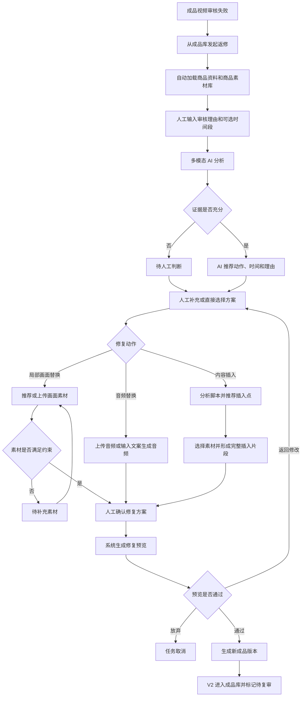

# AI 辅助成品视频返修：业务形态与业务流程

> 文档状态：业务方案 V1，可进入产品原型与技术拆解
> 适用范围：成品视频审核失败后的局部返修
> 核心目标：不重做整条视频，只修改审核问题涉及的部分，并生成可复审的新版本
> 第一版原则：AI 分析和推荐，人工确认，系统确定性执行

## 1. 产品定位

本产品是一个 **AI 辅助的成品视频返修工作台**，不是完整的视频剪辑器，也不是无人审核的自动修片系统。

它解决的核心问题是：

> 成品视频被审核打回后，用户无需返回原剪辑项目，而是直接基于成品视频、审核理由、商品资料和商品素材库完成局部返修，生成新的成品版本。

完整价值链为：

```text
审核失败
  -> AI 理解并定位问题
  -> AI 推荐最小修改动作
  -> 系统从当前商品素材库寻找素材
  -> 人工确认方案和素材
  -> 系统生成修复预览
  -> 人工验收
  -> 输出待复审的新成品版本
```

核心业务原则是：

> 只修改审核要求涉及的部分，最大限度保留已经合格的内容。

## 2. 业务前提

第一版建立在以下强约束上：

1. 每条成品视频必须关联一个商品；
2. 每个商品必须拥有独立的商品素材库；
3. 商品资料是产品事实、卖点、参数和合规文案的可信来源；
4. 默认禁止跨商品使用素材；
5. 不同 SKU、容量、颜色或包装版本不能默认混用；
6. 返修不依赖原剪辑项目，也不强制要求完整的历史来源链路；
7. 原成品永不覆盖，每次成功返修都生成新版本。

基础业务关系如下：

```text
商品
├── 商品资料
│   ├── 名称与 SKU
│   ├── 商品图片
│   ├── 卖点与参数
│   ├── 使用说明
│   └── 合规文案
├── 商品素材库
│   ├── 视频素材
│   ├── 图片素材
│   └── 素材分析与切片结果
└── 成品视频
    ├── V1
    ├── V2
    └── V3
```

创建返修任务时，系统通过以下关系自动加载业务上下文：

```text
成品视频 -> product_id -> 商品资料 + 商品素材库
```

## 3. 业务参与者

### 3.1 审核或运营人员

负责：

- 从成品库选择被打回的视频；
- 输入审核失败理由；
- 可选地标记问题时间段；
- 可选地补充期望修复结果。

### 3.2 AI 系统

负责：

- 理解审核理由；
- 分析原视频的画面、音频和脚本结构；
- 定位问题区间；
- 判断受影响的轨道；
- 推荐修复动作和时间范围；
- 推荐候选素材及其使用区间；
- 对内容插入推荐合适的插入位置；
- 展示判断依据、缺失信息和风险。

AI 只负责分析、推荐和解释，不能代替人工进行最终确认。

### 3.3 人工编辑或运营人员

负责：

- 确认或修改 AI 的判断；
- 调整问题时间范围或插入点；
- 选择、裁剪或上传素材；
- 确认口播文案和商品事实；
- 对比修复预览与原视频；
- 决定生成新版本、返回修改或放弃任务。

## 4. 三种返修动作

### 4.1 局部画面替换

适用场景：

- 某一时间段没有展示商品；
- 展示了错误画面或错误商品；
- 商品不清晰；
- 某段画面质量不合格；
- 原音频正确，只需要调整画面。

执行规则：

- 替换指定时间段的视频画面；
- 移除替换素材自身的音频；
- 保留原成品的完整音轨；
- 保持原视频总时长不变；
- 替换区间之后的内容不发生时间偏移。

```text
画面：原画面 ── 替换画面 ── 原画面
音频：原音频 ─────────────── 原音频
时长：保持不变
```

### 4.2 音频替换

适用场景：

- 口播内容错误；
- 商品参数或卖点说错；
- 发音错误；
- 局部音频缺失；
- 整条配音需要更换。

执行规则：

- 保留原视频画面；
- 替换局部或全部音频；
- 保持视频总时长不变；
- 对音频边界进行基础淡入淡出；
- 第一版直接替换混合音轨，不做人声与背景音乐分离；
- 第一版不自动修改字幕。

### 4.3 内容插入

适用场景：

- 原视频完全缺少一个必要卖点；
- 缺少产品使用方法；
- 缺少品牌、产品或活动说明；
- 必须新增画面和音频才能满足审核要求。

执行规则：

- 先分析原视频的时间轴脚本；
- 判断缺失内容在叙事结构中的作用；
- 在完整口播和镜头边界之间寻找候选插入点；
- 使用商品素材和音频形成完整插入片段；
- 在人工确认的位置插入完整音视频；
- 插入点之后的原视频整体顺延；
- 最终视频时长增加。

```text
原视频前半段 -> 新增内容 -> 原视频后半段
```

## 5. AI 理解和定位问题

### 5.1 AI 输入

第一版向多模态 AI 提供以下信息：

1. 人工输入的审核失败理由；
2. 人工标记的问题时间段，如有；
3. 人工补充的期望修复结果，如有；
4. 原成品的低清分析代理或目标区间视频；
5. 带时间戳的视频关键帧；
6. 带时间戳的语音转写；
7. 镜头切换边界和口播句子边界；
8. 问题区间前后的画面和语音上下文；
9. 商品名称、图片、卖点、参数、使用说明和合规文案；
10. 商品素材库的素材描述和切片结果。

系统不应只依赖语音转写，因为无口播画面、商品展示和烧录字幕都可能承载业务信息。

### 5.2 时间定位优先级

问题时间范围采用以下优先级：

```text
人工在播放器中打点
  > 审核理由中的明确时间
  > AI 自动定位
```

当用户提供明确时间时，AI 重点分析目标区间以及前后各若干秒；当没有明确时间时，AI 先对全片粗定位，再对候选区间精细分析。

AI 可以推荐更合理的镜头或句子边界，但最终执行区间必须由人工确认。

### 5.3 AI 必须回答的问题

AI 的分析结果必须分别回答：

1. 审核理由要求修改什么；
2. 是否能在视频中找到相应证据；
3. 问题发生在哪个时间段；
4. 问题影响画面、音频，还是缺少完整内容；
5. 推荐使用哪一种修复动作；
6. 推荐动作的判断依据是什么；
7. 当前还缺少哪些信息或素材；
8. 是否需要人工重点确认风险。

建议输出结构：

```json
{
  "issue_found": true,
  "issue_category": "PRODUCT_NOT_VISIBLE",
  "affected_tracks": ["visual"],
  "reported_range": {"start": 6.0, "end": 10.0},
  "suggested_range": {"start": 5.9, "end": 10.1},
  "expected_result": "展示当前商品瓶身",
  "recommended_action": "VISUAL_REPLACE",
  "reason": "原口播可以保留，但目标区间没有展示当前商品",
  "confidence_level": "high",
  "missing_information": ["尚未确认替换素材"],
  "requires_human_confirmation": true
}
```

第一版使用“高、中、低”置信等级，不展示未经校准的精确百分比。

## 6. 修复动作选择规则

AI 按照以下逻辑推荐动作：

```text
问题能否在原有时间段内解决？
├── 不能，需要新增完整内容
│   └── 内容插入
└── 能
    ├── 只影响画面
    │   └── 局部画面替换
    ├── 只影响音频
    │   └── 音频替换
    └── 画面和音频同时错误
        └── 第一版拆分为两次返修
```

具体判断原则：

- “某段没有商品画面”通常属于局部画面替换；
- “某段口播错误但画面正确”属于音频替换；
- “整条视频从未介绍必要内容”属于内容插入；
- “已有内容表达得不好”优先考虑替换；
- “必要内容根本不存在”才考虑插入；
- 画面和音频同时需要替换时，第一版不能错误归类为内容插入。

证据不足时，AI 不得强行选择动作，任务进入“待人工判断”。

## 7. 内容插入的位置判断

### 7.1 时间轴脚本

系统先将原视频还原为带时间轴的多模态脚本：

| 时间 | 口播或音频 | 画面 | 脚本作用 |
|---|---|---|---|
| 0–3 秒 | 用户痛点提问 | 人物近景 | 开场钩子 |
| 3–7 秒 | 引出商品 | 商品首次出现 | 产品引入 |
| 7–15 秒 | 说明核心成分 | 商品与质地特写 | 核心卖点 |
| 15–24 秒 | 展示使用效果 | 人物使用商品 | 使用效果 |
| 24–30 秒 | 说明活动价格 | 商品与价格信息 | 促销信息 |
| 30–34 秒 | 引导购买 | 商品定格 | 行动引导 |

脚本作用第一版限制为：

- 开场钩子；
- 用户痛点；
- 产品引入；
- 商品展示；
- 核心卖点；
- 使用方法；
- 效果证明；
- 促销信息；
- 行动引导；
- 过渡内容。

### 7.2 候选插入点

系统只在以下合法边界生成候选点：

- 一句话结束之后；
- 下一句话开始之前；
- 一个镜头结束之后；
- 音频停顿或适合转场的位置；
- 前一段语义已经完整的位置。

禁止：

- 切断人物正在说的一句话；
- 切断连续动作；
- 插入价格、倒计时或强连续促销内容中间；
- 破坏促销信息到行动引导之间的转化链路。

候选位置根据以下维度排序：

- 与缺失内容的语义关联；
- 是否符合正常叙事顺序；
- 镜头边界完整性；
- 音频边界完整性；
- 对原视频节奏和转化链路的干扰程度。

AI 应给出多个候选点、推荐理由和风险，由人工最终选择。

## 8. 素材获取与推荐

### 8.1 素材来源

第一版支持两个正式入口：

1. 当前商品素材库；
2. 用户临时上传。

AI 生成商品视频可以作为后续扩展，第一版不依赖该能力。

临时上传素材可以选择：

- 仅用于当前返修任务；
- 保存到当前商品素材库供后续使用。

### 8.2 素材入库分析

素材进入候选池前至少需要记录：

- 素材 ID 和商品 ID；
- 素材类型；
- 时长、分辨率、帧率和画面比例；
- 镜头切片；
- 每个片段的内容描述；
- 展示部位和动作标签；
- 是否有人物、字幕、水印和音频；
- 清晰度和可解码状态；
- 使用权限与可用状态。

第一版业务标签控制在：

- 产品全貌；
- 产品包装；
- 产品细节；
- 产品质地；
- 手持展示；
- 使用过程；
- 使用效果；
- 场景展示；
- 品牌展示；
- 促销展示。

### 8.3 候选检索

系统先执行硬性过滤：

- 商品或 SKU 必须一致；
- 素材状态必须可用；
- 文件必须可正常解码；
- 清晰度达到最低要求；
- 比例能够合理适配；
- 可用片段长度满足目标区间；
- 使用权限满足当前业务。

通过硬性过滤后，再按照以下条件排序：

- 内容语义是否满足修复目标；
- 商品是否清晰；
- 景别和构图是否合适；
- 与前后镜头是否连续；
- 素材时长是否接近目标时长；
- 是否存在字幕、水印或错误信息风险。

每个候选素材必须展示：

- 预览；
- 推荐使用区间；
- 推荐理由；
- 风险提示；
- “使用此素材”操作。

AI 可以排序，但不能静默替用户选定素材。

找不到合格素材时，任务进入“待补充素材”，不能跨商品借用素材或自动降级为明显不合格素材。

## 9. 素材如何应用到原视频

### 9.1 局部画面替换

假设目标区间为 6–10 秒，目标长度为 4 秒：

1. 用户从候选素材中选择一个片段；
2. 用户或 AI 推荐素材入点和出点；
3. 系统将素材裁剪为目标长度；
4. 系统适配原视频分辨率、比例和帧率；
5. 系统移除素材自身音频；
6. 系统将素材放置到原视频 6–10 秒的视频轨道；
7. 系统保留原成品完整音轨；
8. 系统生成真实合成预览。

素材时长处理规则：

- 长于目标区间：裁剪并由人工确认素材区间；
- 等于目标区间：直接使用；
- 略短于目标区间：仅允许有限度降速；
- 明显短于目标区间：禁止使用，要求更换素材；
- 禁止默认循环播放动作素材；
- 图片素材如在第一版启用，只生成简单且可预览的运动镜头。

比例适配支持：

- 居中裁剪；
- 保留完整画面并使用模糊背景填充；
- 人工调整裁剪位置。

禁止将不同画面比例直接拉伸变形。

### 9.2 内容插入

内容插入需要先形成一个独立的完整音视频片段，再插入原成品。

第一版支持：

1. 用户上传已经完成的音视频片段；
2. 使用一个商品视频片段和一段新音频合成插入片段。

系统负责：

- 统一视频分辨率、比例、帧率和编码；
- 统一音频采样率和音量；
- 对视听边界进行基础过渡；
- 在人工确认的插入点切开原视频；
- 插入完整片段；
- 顺延原视频后续内容；
- 验证最终音画同步和时长。

第一版不自动混剪多个复杂镜头，也不自动延长原背景音乐。

## 10. 端到端业务流程



### 10.1 发起返修

用户从成品库选择被打回的视频，系统自动带入：

- 原成品视频；
- 当前商品及商品资料；
- 当前商品素材库；
- 视频时长、分辨率和音视频信息。

用户输入：

- 审核失败理由，必填；
- 问题时间段，可选；
- 期望修复结果，可选。

### 10.2 AI 分析

系统生成：

- 视频时间轴脚本；
- 语音转写和关键帧；
- 问题候选时间段；
- 问题分类和影响轨道；
- 推荐修复动作；
- 判断依据、风险和待补充信息。

AI 分析失败不能阻塞人工操作。

### 10.3 人工确认方案

返修工作台展示：

- 原视频播放器；
- 审核理由；
- AI 判断依据；
- 问题时间段和上下文；
- 推荐修复动作；
- 人工调整入口。

用户可以采用、调整或完全覆盖 AI 建议。

### 10.4 配置修复内容

- 局部画面替换：选择素材并设置素材入点和出点；
- 音频替换：上传音频或输入文案生成语音；
- 内容插入：确认插入点、素材、口播和新增时长。

### 10.5 生成预览

系统使用确定性媒体处理完成：

- 素材裁剪；
- 比例和帧率适配；
- 视频或音频替换；
- 内容插入；
- 基础视听过渡；
- 音量归一化；
- 预览文件生成与验证。

### 10.6 人工验收

页面同时展示：

- V1 原视频；
- V2 修复预览；
- 实际执行动作；
- 使用素材；
- 修改区间或插入点；
- 风险提示。

用户可以：

- 确认生成新成品；
- 返回修改；
- 放弃任务。

### 10.7 输出新成品

人工确认后：

- 原始 V1 保持不变；
- 预览确认为正式 V2；
- V2 进入成品库；
- V2 状态为“待复审”；
- 系统记录 V2 来源于 V1 以及执行的修复动作；
- 第一版不自动提交外部审核平台。

## 11. 任务状态

```text
草稿
  -> AI 分析中
  -> 待确认方案
      -> 待人工判断
      -> 待补充素材
  -> 待生成预览
  -> 处理中
      -> 处理失败
      -> 待确认预览
          -> 返回修改
          -> 已取消
          -> 返修完成
```

需要明确区分：

- AI 分析失败：无法得出可靠建议，但允许人工继续；
- 待补充素材：方案成立，但当前没有可执行素材；
- 视频处理失败：方案和素材已确认，但媒体渲染失败。

## 12. 核心业务数据

第一版返修任务至少记录：

```text
repair_task_id
source_video_id
source_video_version
product_id
review_reason
expected_result
reported_range
ai_suggested_range
confirmed_range / insert_point
ai_diagnosis
repair_action
selected_material_id
material_in / material_out
insert_audio_id
preview_video_id
output_video_id
output_video_version
task_status
```

基础版本关系只要求：

```text
V2 由 V1 返修生成
```

不要求为了返修而伪造剪辑项目或原始素材来源链路。

## 13. 第一版产品边界

第一版明确限制：

1. 一个返修任务只执行一种修复动作；
2. 多个不同问题通过连续版本分步处理；
3. AI 只推荐，不自动批准或发布；
4. AI 失败时允许人工继续操作；
5. 局部画面替换和音频替换不改变总时长；
6. 只有内容插入增加总时长；
7. 第一版不处理字幕替换；
8. 第一版不做人声与背景音乐分离；
9. 第一版不自动混剪多个复杂镜头；
10. 第一版不依赖原剪辑项目；
11. 第一版禁止跨商品自动使用素材；
12. AI 不得编造商品事实、功效、参数和使用方法；
13. 所有结果必须先生成预览，人工确认后才能进入成品库；
14. 不覆盖原成品，不自动提交外部审核。

当同一时间段的画面和音频都需要修改时，第一版采用连续返修：

```text
V1 -> 局部画面替换 -> V2
V2 -> 音频替换 -> V3
```

后续版本再评估是否增加“完整音视频片段替换”或多动作修复计划。

## 14. 第一版成功标准

第一版完成的判断标准不是 AI 是否全自动，而是以下业务闭环是否稳定成立：

1. 用户可以从成品库选择被打回的视频；
2. 系统能够自动获得对应商品及商品素材库；
3. 用户可以输入审核理由并标记问题时间；
4. AI 能够给出可解释的定位和修复建议；
5. 人工可以覆盖 AI 判断；
6. 系统能够完成局部画面替换；
7. 系统能够完成局部或全片音频替换；
8. 系统能够在合理位置插入完整音视频内容；
9. 用户可以对比原视频和真实修复预览；
10. 确认后能够生成可播放、可追溯、待复审的新版本；
11. 任一 AI 能力失败时，人工路径仍然可以完成任务。

## 15. 产品总结

该产品的业务形态不是“让 AI 自动重新剪一条视频”，而是建立一条受控的局部返修流水线：

```text
成品库中的审核失败视频
  + 人工审核理由
  + 商品真实资料
  + 商品独立素材库
        ↓
多模态 AI 理解、定位、推荐和解释
        ↓
人工确认动作、时间、素材和内容
        ↓
系统执行确定性的局部媒体处理
        ↓
原版与修复版对比验收
        ↓
生成待复审的新成品版本
```

这一形态兼顾了效率与可控性：AI 降低理解问题、寻找素材和制定方案的成本，人工守住商品真实性、内容合规和最终质量，媒体处理系统保证实际输出可重复、可验证、可追溯。
