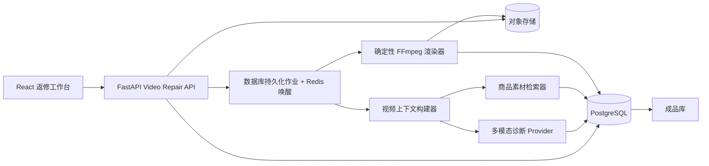
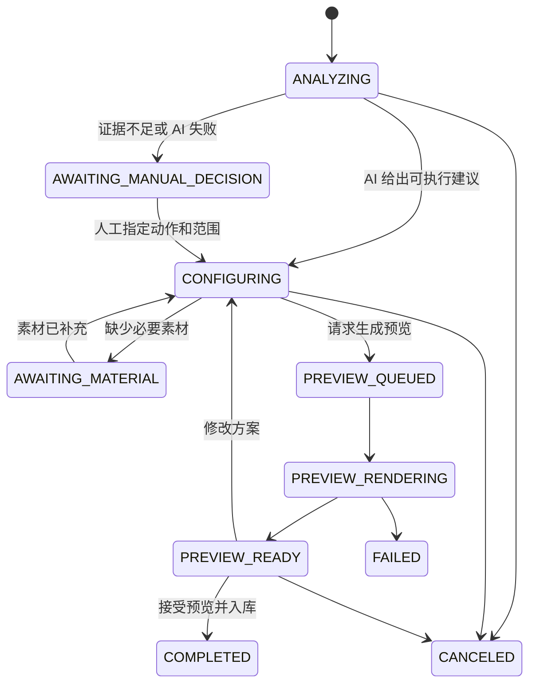

# AI 辅助成品视频返修技术实现方案

> 文档状态：技术设计 V1
> 对应业务文档：`28-CODEX-AI-ASSISTED-VIDEO-REPAIR-BUSINESS-FLOW.md`
> 适用范围：从成品库发起审核返修，完成 AI 诊断、素材选择、真实预览和新版本入库
> 目标：在现有 FastAPI、SQLAlchemy、React、对象存储和 FFmpeg 基础上渐进实现，不依赖原剪辑项目

## 1. 技术目标

第一版必须形成以下可执行闭环：

```text
成品 V1
  -> 创建返修任务
  -> 异步构建视频分析上下文
  -> AI 诊断并推荐一种修复动作
  -> 人工确认时间、动作和素材
  -> 异步生成真实完整预览
  -> 人工验收预览
  -> 将预览确认为正式 V2
  -> V2 进入成品库并等待复审
```

技术实现遵循以下原则：

1. 新返修链路直接处理成品文件，不依赖 `EditingPlanVersion` 或原剪辑项目；
2. 一个任务只包含一个修复动作；
3. AI 只产生结构化建议，不产生或执行 FFmpeg 命令；
4. FFmpeg 参数由确定性代码根据已批准动作生成；
5. 数据库是任务状态的权威来源，Redis 只用于唤醒和互斥；
6. 所有长任务异步执行，API 请求不等待 AI 或 FFmpeg 完成；
7. 预览必须是实际渲染结果，任务修改后旧预览立即失效；
8. 人工确认的是一个冻结的预览与方案快照；
9. 原 V1 永不覆盖，V2 使用新的 `VideoAsset` 记录；
10. 旧返修任务保持可读、可渲染，新任务使用新版协议。

## 2. 现有实现盘点

### 2.1 可复用能力

当前代码已经具备：

- `VideoRepairInput` 和 `VideoRepairTask` 领域模型；
- 成品库中的 `VideoAsset.product_id` 强关联；
- 商品资料、`ProductFact` 和商品素材库；
- `VideoAssetAnalysis`、`VideoHighlight` 和视频分析队列；
- 审核理由时间解析；
- 诊断 JSON Schema 与规则降级；
- 同商品候选素材检索和候选快照；
- 方案冻结、并发更新时间校验；
- 对象存储读取与上传；
- FFmpeg 视频处理和输出探测；
- 生成新 `VideoAsset`、继承标签和触发新视频分析；
- React 返修创建页、工作台和任务列表页。

### 2.2 与新业务模型的主要差距

| 领域 | 当前实现 | 目标实现 |
|---|---|---|
| 动作 | `VISUAL_REPLACE`、`AV_SEGMENT_REPLACE`、`PROCESS_INSERT` | `VISUAL_REPLACE`、`AUDIO_REPLACE`、`CONTENT_INSERT` |
| 无剪辑项目成品 | 只支持局部画面替换 | 三种动作全部直接处理成品文件 |
| AI 输入 | 将上下文 JSON 作为纯文本发送 | 真实关键帧图像、ASR、镜头边界、商品事实和审核文本 |
| ASR 字段 | 分析写入 `transcript.segments`，返修读取其他字段 | 统一读取和规范化 `transcript.segments` |
| 商品信息 | 主要读取已确认 `ProductFact` | 同时读取商品基础资料、确认事实和参考图 |
| 内容插入 | 依赖原剪辑方案 | 分割成品文件并插入独立音视频片段 |
| 音频替换 | 与整段音视频替换混在一起 | 独立音频动作，保留画面和总时长 |
| 长任务 | 创建和渲染请求内同步执行 | 数据库持久化任务加异步 worker |
| 预览 | 批准后直接生成正式 V2 | 先生成完整真实预览，人工确认后晋升为 V2 |
| 状态 | 任务状态同时承担多个阶段 | 任务主状态加独立预览/作业状态 |

当前 `OpenAICompatibleDiagnosisProvider` 实际只把 JSON 文本发给模型，并没有发送图片或视频，因此名称上的“多模态”还未形成真实多模态输入。新版必须修正这一点。

## 3. 目标架构



### 3.1 模块职责

#### API 层

- 参数校验和租户权限检查；
- 创建任务、更新草稿和选择素材；
- 请求生成预览；
- 接受预览并生成正式成品记录；
- 查询任务、预览和作业状态；
- 不在请求线程内执行 AI 或 FFmpeg 长任务。

#### 分析编排层

- 确保源成品已有可用分析；
- 加载审核理由、视频分析、商品资料和商品素材；
- 构建时间轴脚本与多模态上下文；
- 调用 AI Provider；
- 校验 AI 输出并执行规则降级；
- 生成候选动作和候选素材。

#### 计划与能力层

- 定义三种动作的不可变能力契约；
- 校验时间范围、插入点、素材和音频来源；
- 计算预期时长变化；
- 生成可哈希、可冻结的执行计划。

#### 媒体执行层

- 下载源成品和已选素材；
- 规范化视频、音频、帧率、分辨率和时基；
- 根据动作生成受控 FFmpeg filter graph；
- 验证输出音轨、画面、时长和尺寸；
- 上传预览文件并记录内容哈希；
- 不读取 AI 自由生成的命令参数。

#### 版本入库层

- 将已确认预览晋升为新的 `VideoAsset`；
- 保留 V1，并记录 V2 来源；
- 继承商品、公共标签和素材来源；
- 设置为待复审状态；
- 触发 V2 的异步视频分析。

## 4. 领域协议升级

### 4.1 动作枚举

新版动作定义为：

```python
RepairAction = Literal[
    "VISUAL_REPLACE",
    "AUDIO_REPLACE",
    "CONTENT_INSERT",
    "UNSUPPORTED",
]
```

动作能力：

```python
REPAIR_CAPABILITIES = {
    "VISUAL_REPLACE": {
        "affected_tracks": ["video"],
        "duration_policy": "KEEP_TOTAL_DURATION",
        "requires_visual_material": True,
        "requires_audio_input": False,
        "preserve_source_audio": True,
    },
    "AUDIO_REPLACE": {
        "affected_tracks": ["audio"],
        "duration_policy": "KEEP_TOTAL_DURATION",
        "requires_visual_material": False,
        "requires_audio_input": True,
        "preserve_source_video": True,
    },
    "CONTENT_INSERT": {
        "affected_tracks": ["video", "audio"],
        "duration_policy": "EXTEND_TIMELINE",
        "requires_visual_material": True,
        "requires_audio_input": True,
    },
}
```

### 4.2 旧动作兼容

旧任务不能直接改写 JSON，否则会破坏审计和已批准计划。

兼容策略：

- `video_repair_plan.v3` 继续由旧渲染器读取；
- 新任务只生成 `video_repair_plan.v4`；
- `AV_SEGMENT_REPLACE` 作为旧动作只读显示，不自动迁移为 `AUDIO_REPLACE`；
- `PROCESS_INSERT` 作为旧动作只读显示，新任务使用 `CONTENT_INSERT`；
- API 序列化时返回 `schema_version`，前端按版本选择兼容展示；
- 老任务允许完成原流程，但不能在新版工作台中修改为新动作。

原因是旧“整段音视频替换”和新“音频替换”语义不同，不能进行无损自动映射。

## 5. 数据模型

### 5.1 `video_repair_inputs` 扩展

新增：

```text
expected_result TEXT NOT NULL DEFAULT ''
```

继续保留不可变输入快照：

- 审核理由；
- 人工问题时间段；
- 审核来源和平台；
- 人工填写的期望修复结果；
- 原始外部审核载荷。

### 5.2 `video_repair_tasks` 扩展

新增建议字段：

```text
product_id                  BIGINT NOT NULL
schema_version              VARCHAR(32) NOT NULL DEFAULT 'video_repair_task.v2'
draft_revision              INTEGER NOT NULL DEFAULT 1
accepted_preview_id         BIGINT NULL
cancel_reason               TEXT NOT NULL DEFAULT ''
```

说明：

- `product_id` 在创建任务时从源成品复制并冻结，用于审计和防止后续错误关联；
- `draft_revision` 每次修改动作、时间、素材或音频时递增；
- 预览只对生成时的 `draft_revision` 有效；
- `accepted_preview_id` 指向人工最终确认的真实预览。

现有 `base_plan_version_id` 仅保留给旧任务，新 `v2` 任务必须为 `NULL`，不再参与新渲染链路。

### 5.3 新增 `video_repair_attachments`

用于持久化任务级上传文件和生成音频：

```text
id
tenant_id
task_id
kind               AUDIO | VIDEO | IMAGE
source             UPLOAD | TTS | PRODUCT_LIBRARY
object_url
filename
content_hash
duration_ms
width
height
has_audio
metadata_json
status             UPLOADING | READY | FAILED
created_by
created_at
```

商品库中的现有视频继续引用 `VideoAsset`，商品图片继续引用 `ProductAsset`；任务上传或 TTS 结果通过附件表统一管理。

### 5.4 新增 `video_repair_previews`

```text
id
tenant_id
task_id
draft_revision
plan_hash
status             QUEUED | RENDERING | READY | FAILED | SUPERSEDED
object_url
content_hash
duration_seconds
width
height
source_snapshot_json
plan_snapshot_json
error_code
error_message
created_by
created_at
completed_at
```

规则：

- 一个任务可以保留多次预览记录；
- 草稿改变后，之前的 `READY` 预览改为 `SUPERSEDED`；
- 只有当前 `draft_revision` 且状态为 `READY` 的预览可以被接受；
- 接受预览后保存其方案、源文件和素材内容哈希；
- 正式 V2 直接使用已验收预览的媒体对象，避免再次渲染产生差异。

### 5.5 新增 `video_repair_jobs`

```text
id
tenant_id
task_id
job_type           ANALYZE | RENDER_PREVIEW | FINALIZE
status             QUEUED | RUNNING | SUCCEEDED | FAILED | CANCELED
idempotency_key
payload_json
attempts
max_attempts
error_code
error_message
started_at
finished_at
created_at
updated_at
```

数据库作业记录是持久化事实，Redis 只唤醒 worker。唯一键建议为：

```text
(tenant_id, job_type, idempotency_key)
```

## 6. 主状态机

新版任务状态：

```text
ANALYZING
AWAITING_MANUAL_DECISION
AWAITING_MATERIAL
CONFIGURING
PREVIEW_QUEUED
PREVIEW_RENDERING
PREVIEW_READY
COMPLETED
FAILED
CANCELED
```

状态流转：



实现时必须用集中式 transition 函数校验状态，不允许 API 直接任意赋值。

## 7. 修复计划 `video_repair_plan.v4`

### 7.1 通用结构

```json
{
  "schema_version": "video_repair_plan.v4",
  "task_id": 13,
  "draft_revision": 4,
  "source_asset_id": 149,
  "product_id": 8,
  "action": {},
  "diagnosis_snapshot": {},
  "warnings": [],
  "generated_by": {},
  "updated_by": "USER"
}
```

第一版只允许一个 `action`，不使用动作数组，避免产生“实际上支持多动作”的错误暗示。

### 7.2 局部画面替换

```json
{
  "type": "VISUAL_REPLACE",
  "target_range": {"start_ms": 6000, "end_ms": 10000},
  "material": {
    "ref_type": "VIDEO_ASSET",
    "ref_id": 231,
    "source_range": {"start_ms": 2100, "end_ms": 6100},
    "content_hash": "..."
  },
  "fit_mode": "COVER",
  "crop": {"x": 0.5, "y": 0.5},
  "speed_ratio": 1.0,
  "transition": {"type": "CUT", "duration_ms": 0},
  "duration_policy": "KEEP_TOTAL_DURATION"
}
```

### 7.3 音频替换

```json
{
  "type": "AUDIO_REPLACE",
  "target_range": {"start_ms": 6000, "end_ms": 10000},
  "audio": {
    "source_type": "ATTACHMENT",
    "attachment_id": 91,
    "content_hash": "...",
    "source_range": {"start_ms": 0, "end_ms": 3800}
  },
  "fit_policy": "PAD_SILENCE",
  "fade_in_ms": 80,
  "fade_out_ms": 80,
  "duration_policy": "KEEP_TOTAL_DURATION",
  "subtitle_policy": "KEEP_UNCHANGED_WITH_WARNING"
}
```

音频也可以来自 TTS：

```json
{
  "source_type": "TTS",
  "attachment_id": 92,
  "text": "确认后的商品口播文案",
  "voice": "配置中的音色标识"
}
```

### 7.4 内容插入

```json
{
  "type": "CONTENT_INSERT",
  "insert_at_ms": 15000,
  "duration_ms": 5000,
  "visual": {
    "ref_type": "VIDEO_ASSET",
    "ref_id": 242,
    "source_range": {"start_ms": 3000, "end_ms": 8000},
    "content_hash": "..."
  },
  "audio": {
    "source_type": "TTS",
    "attachment_id": 93,
    "text": "取适量均匀涂抹于面部，轻轻按摩至吸收",
    "content_hash": "..."
  },
  "fit_mode": "COVER",
  "transition": {"type": "CUT", "duration_ms": 0},
  "duration_policy": "EXTEND_TIMELINE"
}
```

## 8. 多模态分析实现

### 8.1 视频分析规范化

升级 `VideoAssetAnalysis.analysis_json` 至统一结构：

```json
{
  "schema_version": "video_analysis.v2",
  "summary": "...",
  "transcript": {
    "segments": [],
    "words": [],
    "text": ""
  },
  "shots": [],
  "keyframes": [],
  "ocr_segments": [],
  "script_segments": []
}
```

第一阶段必须先修复字段契约：返修上下文直接读取 `transcript.segments`，同时兼容历史的 `asr_segments` 和 `transcript_segments`。

### 8.2 时间轴脚本生成

脚本段由以下信息融合得到：

- ASR 句子边界；
- 镜头切换边界；
- 关键帧描述；
- OCR 字幕，如可用；
- 原剪辑时间轴，如历史数据恰好存在；
- 商品资料中的标准内容角色。

标准脚本段：

```json
{
  "start_ms": 7000,
  "end_ms": 15000,
  "speech_text": "含有65%精华成分",
  "visual_summary": "商品瓶身和质地特写",
  "role": "PRODUCT_BENEFIT",
  "shot_boundary_start": true,
  "shot_boundary_end": true,
  "evidence_sources": ["ASR", "FRAME", "PRODUCT_FACT"]
}
```

第一版脚本角色限定为固定枚举，不能让模型自由创建无限标签。

### 8.3 两阶段定位

#### 有人工时间范围

- 采用人工时间为 `reported_range`；
- 提取目标区间及前后各 4 秒；
- 提供目标区间内更密集的关键帧；
- AI 可以给出建议边界，但不能覆盖人工范围；
- 人工最终确认 `effective_range`。

#### 无人工时间范围

第一遍粗定位：

- 全片每 2 秒关键帧；
- 完整 ASR；
- 镜头和脚本段摘要；
- 输出最多 3 个候选区间。

第二遍精定位：

- 对候选区间每 0.5 秒取关键帧；
- 提供句子、镜头和音频停顿边界；
- 输出建议区间与证据。

### 8.4 真实多模态消息

Provider 请求必须使用内容数组发送图片，而不是只发送图片描述文本：

```python
messages = [
    {"role": "system", "content": SYSTEM_PROMPT},
    {
        "role": "user",
        "content": [
            {"type": "text", "text": json.dumps(text_context)},
            {"type": "image_url", "image_url": {"url": keyframe_url_1}},
            {"type": "image_url", "image_url": {"url": keyframe_url_2}}
        ]
    }
]
```

关键帧需要在文本上下文中带有稳定 ID 和时间戳，模型返回证据时引用该 ID。

对于不支持图片输入的 Provider，系统必须明确降级为 `RULE_FALLBACK` 或 `TEXT_ONLY`，不能标记为多模态成功。

### 8.5 商品事实边界

AI 上下文只使用：

- `Product` 的基础字段；
- 状态为 `confirmed` 的 `ProductFact`；
- 当前商品参考图；
- 人工输入的 `expected_result`。

AI 不得将未确认事实作为正确口播依据。模型输出中的商品声明必须带 `PRODUCT_FACT` 证据引用，否则只能作为待人工确认建议。

### 8.6 诊断输出 `video_repair_diagnosis.v3`

建议新增：

```json
{
  "issue_found": true,
  "issue_type": "PRODUCT_NOT_VISIBLE",
  "affected_tracks": ["visual"],
  "reported_range": {"start_ms": 6000, "end_ms": 10000},
  "suggested_range": {"start_ms": 5900, "end_ms": 10100},
  "missing_content_role": null,
  "recommended_action": "VISUAL_REPLACE",
  "confidence_level": "HIGH",
  "evidence_sufficiency": "SUFFICIENT",
  "evidence": [],
  "reason": "...",
  "missing_information": [],
  "requires_human_confirmation": true
}
```

不再把未经校准的浮点数直接展示为百分比。内部可保留排序分数，但用户界面只显示等级和证据。

## 9. 动作决策器

动作选择不能完全交给模型自由输出。采用“模型分类 + 确定性规则校验”：

```python
if issue_is_missing_independent_content and requires_new_duration:
    action = "CONTENT_INSERT"
elif affected_tracks == {"visual"}:
    action = "VISUAL_REPLACE"
elif affected_tracks == {"audio"}:
    action = "AUDIO_REPLACE"
elif affected_tracks == {"visual", "audio"}:
    action = "UNSUPPORTED_COMBINED_REPAIR"
else:
    action = "MANUAL_DECISION_REQUIRED"
```

关键限制：

- “缺少画面”不等于“缺少内容”；
- 只有新增独立语义单元且必须延长时间轴时才使用 `CONTENT_INSERT`；
- 画面与音频同时错误时，第一版提示拆分两次返修；
- 无可靠时间或插入点时仍可保存诊断，但不能进入预览渲染；
- 人工覆盖 AI 建议时必须记录覆盖原因和操作者。

## 10. 商品素材检索

### 10.1 候选来源

视频候选优先来自：

```text
VideoAsset.product_id == task.product_id
VideoAsset.asset_kind == "material"
VideoAsset.excluded == false
VideoAsset.reusable_status IN ("approved", "review_required")
```

优先使用 `VideoHighlight` 作为可裁剪片段；没有切片时才将完整 `VideoAsset` 作为低质量候选。

图片候选来自当前商品的 `ProductAsset`，第一版只有启用“图片转简单运动镜头”后才可选。

### 10.2 硬约束

- 租户一致；
- 商品和 SKU 一致；
- 文件存在且可解码；
- 素材未排除；
- 使用权限满足要求；
- 时长满足目标动作；
- 分辨率达到最低要求；
- 内容哈希有效；
- `CONTENT_INSERT` 的视频和音频组合能够形成完整插入片段。

### 10.3 软排序

建议权重：

| 维度 | 权重 |
|---|---:|
| 修复目标语义匹配 | 35% |
| 商品展示正确性 | 25% |
| 与前后文连续性 | 15% |
| 时长适配度 | 10% |
| 画幅与构图适配 | 10% |
| 清晰度 | 5% |

如果某项没有证据，应从分母中移除并重新归一化，而不是给一个中性 `0.5`。否则系统会把“未知”伪装成“中等匹配”。

候选结果必须包含：

- 片段来源；
- 推荐入点和出点；
- 每项评分的证据；
- 风险和缺失证据；
- `RECOMMENDED`、`SELECTABLE_WITH_WARNING` 或 `NOT_SELECTABLE`。

## 11. FFmpeg 媒体执行

所有动作统一以“扁平成品 V1”为输入，不再分为有剪辑计划和无剪辑计划两套新逻辑。

### 11.1 公共规范化

所有输入在进入动作 filter graph 前统一：

- 视频像素格式：`yuv420p`；
- 视频帧率：跟随源视频，缺失时使用 30fps；
- 视频时基：统一并重置 PTS；
- 音频采样率：48kHz；
- 音频声道：立体声；
- 旋转元数据：在画面中实际应用；
- 输出容器：MP4；
- 视频编码：H.264；
- 音频编码：AAC；
- 输出启用 `faststart`。

### 11.2 局部画面替换

处理逻辑：

1. 从候选视频裁剪指定源区间；
2. 按 `COVER`、`CONTAIN_BLUR` 或人工裁剪参数适配画布；
3. 将候选 PTS 移动到目标起点；
4. 仅在目标区间覆盖源视频画面；
5. 完整保留源音轨；
6. 输出时长必须与 V1 相差不超过 100ms。

禁止默认循环短素材。素材不足时只能：

- 在配置允许范围内小幅降速；
- 明确使用图片运动镜头；
- 或要求用户更换素材。

### 11.3 音频替换

处理逻辑：

```text
源音频 0..start
  + 规范化后的新音频，长度严格等于目标区间
  + 源音频 end..duration
```

新音频适配策略：

- 短于目标区间：尾部补静音；
- 长于目标区间：默认拒绝，提示调整文案或时间；
- 只有用户明确允许时才进行有限度变速；
- 边界应用 50–100ms 淡入淡出；
- 全片替换时目标范围为 `0..source_duration`；
- 源视频没有音轨时，先构造静音轨再执行同一逻辑。

烧录字幕不会随音频变化，工作台必须显示明确警告：

> 本次只替换音频，画面中的字幕不会自动更新。

### 11.4 内容插入

先构建独立插入片段：

```text
规范化视觉素材
  + 上传音频或 TTS 音频
  -> 时长一致的插入片段
```

再处理原视频：

```text
V1 画面和音频 0..insert_at
  + 插入片段
  + V1 画面和音频 insert_at..end
```

前、中、后三段分别重置 PTS 后使用 concat 合并。输出时长必须满足：

```text
output_duration ≈ source_duration + insert_duration
```

第一版只支持硬切或极短淡入淡出，不做复杂转场，不自动延展 V1 背景音乐。

### 11.5 输出验证

每次预览渲染完成后必须使用 `ffprobe` 验证：

- 文件存在且非空；
- 至少包含一个视频流和一个音频流；
- 宽高与源成品一致；
- 画面和音频时长满足动作契约；
- 总时长误差不超过约定阈值；
- 可完成首帧和尾帧解码；
- 内容哈希已计算；
- 计划中引用的素材哈希没有变化。

## 12. 真实预览与成品晋升

### 12.1 为什么生成完整预览

第一版建议直接生成完整修复视频作为预览，而不是只生成局部片段。原因是：

- 用户可以检查前后衔接和全片时长；
- 预览与最终成品可以使用同一媒体对象；
- 人工确认后无需重新渲染；
- 避免“局部预览正确，完整输出不同”的风险。

### 12.2 预览生成

请求预览时：

1. 校验当前草稿是否完整；
2. 计算规范化 `plan_hash`；
3. 冻结源成品和素材内容哈希；
4. 创建 `RENDER_PREVIEW` 作业；
5. worker 渲染完整视频；
6. 上传到任务预览目录；
7. 验证成功后将预览设为 `READY`；
8. 任务进入 `PREVIEW_READY`。

相同 `plan_hash` 且素材哈希未变化时，可以复用已经成功的预览。

### 12.3 确认入库

人工接受预览时，在一个数据库事务中：

1. 锁定任务和预览；
2. 确认预览仍属于当前 `draft_revision`；
3. 确认源成品和素材内容哈希未变化；
4. 创建新的 `VideoAsset`；
5. `product_id` 继承自源成品；
6. `asset_kind=final_output`；
7. `library_type=finished`；
8. `reusable_status=review_required`；
9. 保存 V1、素材和附件的来源快照；
10. 任务状态设为 `COMPLETED`；
11. 提交事务后唤醒视频分析 worker。

对象存储可以将预览对象直接晋升或复制到正式输出目录；无论使用哪种方式，正式 `VideoAsset.content_hash` 必须与用户验收的预览一致。

## 13. 异步作业与恢复

### 13.1 作业执行

沿用现有 `video_analysis_queue` 的模式：

- 数据库查找 `QUEUED` 作业；
- 使用 Redis 分布式锁避免重复消费；
- worker 执行后更新作业和任务状态；
- Redis 不可用时数据库仍保留任务；
- 服务启动时将超时 `RUNNING` 作业重新排队。

### 13.2 幂等性

- 分析作业键：`analyze:{task_id}:{input_hash}`；
- 预览作业键：`preview:{task_id}:{draft_revision}:{plan_hash}`；
- 晋升作业键：`finalize:{task_id}:{preview_id}`；
- 已完成任务重复接受预览时返回既有 V2；
- 同一任务同一草稿只能有一个活动预览作业。

### 13.3 重试

- AI 网络错误：最多重试一次，然后降级为人工判断；
- 源文件下载错误：按可重试错误处理；
- FFmpeg 参数或输入非法：不自动重试；
- 对象存储临时错误：有限次数重试；
- 商品素材已变化：取消旧预览并要求重新确认。

## 14. API 设计

### 14.1 创建与查询

```http
POST /video-repair-tasks
GET  /video-repair-tasks
GET  /video-repair-tasks/{task_id}
POST /video-repair-tasks/{task_id}/retry-analysis
POST /video-repair-tasks/{task_id}/cancel
```

创建请求：

```json
{
  "source_asset_id": 149,
  "input": {
    "source_kind": "MANUAL",
    "audit_platform": "INTERNAL",
    "raw_reason": "6到10秒没有展示商品",
    "expected_result": "展示当前商品瓶身",
    "time_ranges": [{"start": 6, "end": 10}],
    "category_hint": "UNKNOWN"
  }
}
```

`POST` 返回 `202 Accepted` 或新建任务对象，状态为 `ANALYZING`，不等待 AI 完成。

### 14.2 草稿配置

```http
PATCH /video-repair-tasks/{task_id}/draft
GET   /video-repair-tasks/{task_id}/materials
POST  /video-repair-tasks/{task_id}/attachments
POST  /video-repair-tasks/{task_id}/tts
```

`PATCH draft` 必须携带：

- `expected_updated_at` 或版本号；
- 动作；
- 时间范围或插入点；
- 素材引用及源区间；
- 音频引用或 TTS 附件；
- 人工覆盖原因，如覆盖 AI 推荐。

更新成功后：

- `draft_revision + 1`；
- 当前有效预览全部设为 `SUPERSEDED`；
- 任务回到 `CONFIGURING`。

### 14.3 预览和确认

```http
POST /video-repair-tasks/{task_id}/previews
GET  /video-repair-tasks/{task_id}/previews
GET  /video-repair-tasks/{task_id}/previews/{preview_id}
POST /video-repair-tasks/{task_id}/previews/{preview_id}/accept
POST /video-repair-tasks/{task_id}/previews/{preview_id}/retry
```

接受预览请求必须携带当前任务版本，以防止用户在过期页面确认旧方案。

### 14.4 API 错误码

至少统一：

```text
SOURCE_ASSET_NOT_FOUND
SOURCE_PRODUCT_MISMATCH
ANALYSIS_NOT_READY
MANUAL_DECISION_REQUIRED
INVALID_TARGET_RANGE
INVALID_INSERT_POINT
MATERIAL_REQUIRED
MATERIAL_PRODUCT_MISMATCH
MATERIAL_DURATION_INSUFFICIENT
AUDIO_REQUIRED
AUDIO_DURATION_EXCEEDED
STALE_REPAIR_TASK
STALE_PREVIEW
PREVIEW_NOT_READY
MEDIA_DOWNLOAD_FAILED
RENDER_FAILED
OUTPUT_VALIDATION_FAILED
```

## 15. 前端工作台

### 15.1 页面结构

工作台按业务顺序展示：

1. 原成品播放器和当前商品；
2. 审核失败事实；
3. AI 诊断、证据和置信等级；
4. 时间轴问题区间或候选插入点；
5. 三种动作选择与人工覆盖；
6. 对应动作配置；
7. 商品素材候选和上传入口；
8. 真实预览与 V1 对比；
9. 接受预览、返回修改或取消任务。

### 15.2 动作配置组件

建议拆分：

```text
VideoRepairWorkbench
├── SourceVideoPanel
├── DiagnosisEvidencePanel
├── TimelineRangeEditor
├── ActionRecommendationPanel
├── VisualReplaceEditor
├── AudioReplaceEditor
├── ContentInsertEditor
├── MaterialCandidatePanel
├── PreviewComparisonPanel
└── RepairTaskActions
```

不继续把所有逻辑堆在单个 `VideoRepairWorkbench.tsx` 中。

### 15.3 前端交互规则

- AI 建议不是最终选择，按钮文案使用“采用建议”；
- 低证据时显示“待人工判断”，不展示伪精确百分比；
- 修改草稿后立即隐藏旧预览的确认按钮；
- 处理状态通过有限间隔轮询任务或作业接口；
- 页面离开后任务继续运行；
- 音频替换时显示烧录字幕风险；
- 内容插入同时展示插入前后文和预计新时长；
- 素材不足显示业务状态，不显示为系统崩溃；
- 用户选择素材前必须可以播放素材和查看推荐区间。

## 16. 安全与业务约束

### 16.1 权限

所有查询都必须同时校验：

- `tenant_id`；
- 用户是否有权访问任务；
- 源成品、商品、素材和附件属于同一租户；
- 素材的 `product_id` 与任务冻结的 `product_id` 一致。

不能只凭前端传入的素材 ID 直接读取对象存储文件。

### 16.2 快照与防篡改

预览和正式输出保存：

- 源视频 `content_hash`；
- 选中素材 `content_hash`；
- 音频附件 `content_hash`；
- 规范化计划 `plan_hash`；
- AI 模型和提示词版本；
- 人工覆盖原因；
- 操作者和确认时间。

任一内容哈希发生变化后，旧预览不能被接受。

### 16.3 商品真实性

- 商品 ID 是硬约束；
- AI 不得跨商品检索；
- AI 不得使用未确认事实生成产品声明；
- 不同 SKU 的共用素材必须由明确的业务配置授权；
- 人工上传素材必须明确归属当前任务或当前商品。

## 17. 可观测性

建议记录以下结构化指标：

- 任务创建量；
- 三种动作分布；
- AI 成功、规则降级和人工覆盖比例；
- 平均分析耗时；
- 平均预览渲染耗时；
- 候选素材为空比例；
- 预览一次通过率；
- 每任务平均预览次数；
- FFmpeg 失败码分布；
- V2 再次被打回比例。

日志中记录任务 ID、作业 ID、预览 ID和请求 ID，但不能记录对象存储签名、API Key 或完整用户隐私数据。

## 18. 测试策略

### 18.1 单元测试

- 审核文本时间解析；
- ASR 字段规范化；
- 商品事实上下文构建；
- 动作决策规则；
- 三种动作计划校验；
- 素材硬约束；
- 缺失评分维度重新归一化；
- 插入点候选排序；
- 状态流转；
- 草稿 revision 和预览失效；
- 计划哈希稳定性。

### 18.2 FFmpeg 集成测试

使用短测试媒体验证：

#### 画面替换

- 目标像素发生变化；
- 原音频哈希或波形保持；
- 总时长不变；
- 目标区间之外画面未变化。

#### 音频替换

- 原画面帧保持；
- 目标音频波形发生变化；
- 目标区间之外音频保持；
- 总时长不变；
- 短音频能够补静音；
- 超长音频被拒绝。

#### 内容插入

- 插入点前后的原帧顺序保持；
- 新片段出现在正确时间；
- 输出时长等于原时长加插入时长；
- 音画同步；
- 插入点为 0 和原视频末尾时仍可处理。

### 18.3 API 测试

- 新建任务异步返回；
- 用户不能访问其他租户任务；
- 跨商品素材被拒绝；
- 过期更新时间被拒绝；
- 修改草稿使旧预览失效；
- 未完成预览不能确认；
- 重复确认返回同一个 V2；
- 已完成任务不能重新修改。

### 18.4 前端测试

- 三种动作切换；
- AI 建议采用和人工覆盖；
- 时间打点；
- 素材播放器和区间选择；
- 音频字幕风险提示；
- 插入后预计时长；
- 预览处理中、失败、过期和完成状态；
- V1/V2 对比播放；
- 素材不足和 AI 失败时仍可人工继续。

## 19. 数据迁移与兼容发布

### 19.1 数据库迁移

使用显式迁移脚本完成：

1. 扩展 `video_repair_inputs`；
2. 扩展 `video_repair_tasks`；
3. 创建附件、预览和作业表；
4. 扩展状态约束；
5. 为现有任务写入旧 `schema_version`；
6. 从 `source_asset.product_id` 回填任务 `product_id`；
7. 为作业状态和任务查询建立索引。

迁移前必须检查：

- 是否存在源成品已经删除的任务；
- 是否存在成品缺少商品关联；
- 是否存在不满足旧状态约束的数据；
- 是否存在活动中的旧任务。

### 19.2 功能开关

建议增加：

```text
VIDEO_REPAIR_V4_ENABLED
VIDEO_REPAIR_ASYNC_WORKER_ENABLED
VIDEO_REPAIR_MULTIMODAL_ENABLED
VIDEO_REPAIR_AUDIO_REPLACE_ENABLED
VIDEO_REPAIR_CONTENT_INSERT_ENABLED
VIDEO_REPAIR_IMAGE_MOTION_ENABLED
```

发布时先启用数据模型和只读兼容，再逐步开放动作。

## 20. 分阶段实施

### 阶段 0：协议和兼容层

目标：新旧任务能够共存。

- 新增 V4 动作、Schema 和功能开关；
- 增加数据库迁移；
- 建立集中状态机；
- 保留 V3 只读和旧渲染入口；
- 修复 `transcript.segments` 字段映射。

验收：旧任务页面不报错，新任务可以创建为 V4 草稿。

### 阶段 1：统一成品文件画面替换与真实预览

目标：先稳定交付最基础、最重要的能力。

- 新版画面替换不依赖剪辑项目；
- 商品素材候选只来自当前商品；
- 支持人工素材入点和出点；
- 新增异步预览和预览表；
- 接受预览后直接生成 V2；
- 拆分前端工作台组件。

验收：任意合法成品都能完成“局部画面替换 -> 预览 -> V2”。

### 阶段 2：音频替换

目标：实现局部和全片音频替换。

- 音频附件上传；
- TTS 生成附件；
- 音频长度校验、补静音和淡入淡出；
- 烧录字幕风险提示；
- FFmpeg 音频集成测试。

验收：画面和总时长不变，目标区间音频正确替换。

### 阶段 3：内容插入

目标：实现单个完整片段插入。

- 时间轴脚本；
- 插入点候选；
- 一个视觉素材加一段音频的片段合成；
- 完整音视频上传插入；
- 插入后的时长和同步验证。

验收：插入点前后原内容保留，新增片段正确出现，总时长正确增加。

### 阶段 4：真实多模态诊断

目标：AI 能够用真实画面和商品事实推荐动作。

- 关键帧多模态消息；
- 两阶段时间定位；
- 商品事实引用；
- `video_repair_diagnosis.v3`；
- 证据充分度和人工降级路径；
- AI 评估集和提示词版本管理。

验收：在固定测试集中，动作推荐、时间定位和证据引用达到约定指标，AI 失败时人工流程仍可完成。

### 阶段 5：素材分析和推荐增强

目标：减少人工寻找素材时间。

- 镜头切片质量提升；
- 商品展示和动作标签；
- 前后文连续性评分；
- 图片简单运动镜头；
- 候选解释和风险展示。

## 21. 建议的首个开发切片

不要同时实现全部能力。第一个可交付切片建议是：

```text
成品库 V1
  -> 输入审核理由和时间范围
  -> 规则或人工选择 VISUAL_REPLACE
  -> 从同商品视频素材选择一个片段
  -> 设置素材入点和出点
  -> 异步生成完整预览
  -> 人工确认
  -> 预览晋升为 V2
```

该切片能够验证最关键的技术基础：

- 成品和商品素材关系是否可靠；
- 时间范围编辑是否可用；
- 扁平成品渲染是否稳定；
- 异步任务和预览状态是否可靠；
- V1/V2 版本关系是否正确；
- 前端是否形成完整人工闭环。

确认这条链路稳定后，再加入音频替换、内容插入和真实多模态自动推荐。这样可以避免同时调试 AI、素材、音频、插入和状态机，导致无法判断问题究竟出在哪一层。

## 22. 技术结论

新版返修模块应从“依赖旧剪辑计划的动作补丁”转变为“围绕成品文件的受控媒体变换系统”。核心技术边界是：

```text
AI：理解、定位、分类、解释和推荐
人工：确认事实、动作、时间、素材和结果
媒体引擎：按冻结计划执行确定性处理
成品库：保留版本和复审状态
```

最优实施顺序不是先把 AI 做复杂，而是先完成统一的成品文件渲染、真实预览、人工确认和版本入库，再逐步提高 AI 定位和素材推荐的自动化程度。
